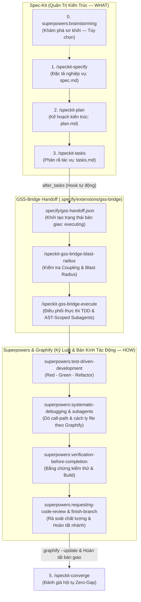

# Zenix — .NET 10 WinUI 3 Modern Database Management System — AI Agent Guidance & Orchestration (`AGENTS.md`)


Tài liệu này là **bản đồ điều phối tối cao (Master Orchestration Guide)** dành cho AI Agent (Antigravity, Claude, Codex, Gemini CLI) khi làm việc trên kho mã nguồn **Zenix**. Mọi hoạt động phát triển, kiểm thử, tái cấu trúc và kiểm toán mã nguồn đều phải tuân thủ nghiêm ngặt kiến trúc desktop hiện đại trên Windows (.NET 10 WinUI 3 + Windows App SDK), phương pháp luận **Spec-Driven Development (Spec-Kit)** kết hợp kiến trúc mã nguồn **Graphify** và kỷ luật kỹ thuật **Superpowers** qua cầu nối **`gss-bridge`**, tích hợp khả năng dịch ngược và phân tích nhị phân **REA (Reverse Engineer Anything)**, cùng các chuẩn mực chất lượng cấp độ **Tier-1 Enterprise**.


---


## 1. Tổng Quan Kiến Trúc Hệ Thống (Architecture Topology)


Zenix là ứng dụng quản lý và truy vấn cơ sở dữ liệu (MySQL, MariaDB...) hiệu năng cao, hiện đại trên nền tảng Windows desktop:


### 1.1 Phân Hệ Khách Hàng Giao Diện (Presentation Layer)

- **Công nghệ cốt lõi**: .NET 10 (`net10.0-windows10.0.26100.0`), C# (LangVersion `preview`), Windows App SDK (WinUI 3), WinUIEx. Ứng dụng Desktop Unpackaged (`<WindowsPackageType>None</WindowsPackageType>`).

- **Thư viện UI chính**: Windows App SDK (WinUI 3 / `Microsoft.UI.Xaml`), `WinUIEx` (quản trị cửa sổ, Mica backdrop, window lifecycle), `CommunityToolkit.WinUI.UI.Controls.DataGrid`, mang trải nghiệm Fluent Design nguyên bản (Mica backdrop, modern controls, ContentDialog, InfoBar, System Theme Sync).

- **Mô hình kiến trúc**: **Clean MVVM** phân lớp nghiêm ngặt, sử dụng thư viện chuẩn ngành `CommunityToolkit.Mvvm`:

  - **Views** (`Views/Pages/`, `Views/Windows/`, `Dialogs/Views/`): Khai báo giao diện thuần XAML WinUI 3, không chứa logic nghiệp vụ (No Code-Behind Business Logic).

  - **ViewModels** (`ViewModels/Pages/`, `ViewModels/Windows/`): Điều khiển luồng nghiệp vụ, sử dụng source generators (`[ObservableProperty]`, `[RelayCommand]`), UI-agnostic hoàn toàn độc lập với các kiểu trực quan của WinUI 3 (`UIElement`, `Window`).

  - **Controls & Helpers** (`Controls/`, `Helpers/`): Custom controls, behaviors, và converters (`PreferNotNullConverter`, etc.).


### 1.2 Phân Hệ Dịch Vụ Nền Tảng & DI (Application Services & Host)

- **Generic Host & Dependency Injection**: Vận hành trên nền `Microsoft.Extensions.Hosting` (`IHost`, `IServiceCollection`), đăng ký vòng đời Services rõ ràng (Singleton / Transient / HostedService).

- **Dịch vụ điều phối chính**:

  - `ApplicationHostService`: Khởi tạo và quản lý vòng đời ứng dụng, điều hướng cửa sổ chính (`INavigationWindow`).

  - `NavigationService`: Quản trị chuyển trang mượt mà giữa các phân hệ (Connections, Database Objects, Query Editor, Settings).

  - `ThemeService` & `ApplicationThemeManager`: Đồng bộ theme hệ thống (Dark/Light/High Contrast) tức thời.

  - `MessengerService`: Trao đổi thông điệp bất đồng bộ, decoupled giữa các thành phần qua `WeakReferenceMessenger`.

  - `ConnectionStorageService` & `PasswordEncryptor`: Quản lý lưu trữ kết nối an toàn với cơ chế mã hóa mật khẩu bảo vệ dữ liệu người dùng.

- **Tiến trình đơn (Single Instance IPC)**: `Bootstrap.cs` sử dụng `Global\Zenix.SingleInstance.App` (Windows Mutex + Named Pipe Server) để đảm bảo chỉ có một instance hoạt động, tự động kích hoạt cửa sổ khi người dùng mở lại app.


### 1.3 Phân Hệ Kết Nối Cơ Sở Dữ Liệu (Database Engine)

- **Thư viện kết nối**: `MySqlConnector` tối ưu hóa bất đồng bộ không phong tỏa luồng UI.

- Hỗ trợ quản lý phiên kết nối, kiểm tra tính khả dụng (Ping/Test Connection), thực thi truy vấn an toàn và phân trang dữ liệu.


---


## 2. Bất Biến Ranh Giới & Hiến Chương Dự Án (`CONSTITUTION.md`)


Mọi đề xuất mã nguồn hoặc thay đổi kiến trúc **bắt buộc tuân thủ 100%** Hiến chương dự án v1.19.0 ([`.specify/memory/constitution.md`](file:///D:/DEV/WinUI/Zenix/.specify/memory/constitution.md)):


1. **Principle I: Clean MVVM & Type Safety**:

   - Sử dụng triệt để `CommunityToolkit.Mvvm` (`[ObservableProperty]`, `[RelayCommand]`).

   - ViewModels hoàn toàn UI-agnostic; cấm phụ thuộc trực tiếp vào visual tree WinUI 3 (`UIElement`, `FrameworkElement`, `Window`).

   - UI thread synchronization bắt buộc đi qua `DispatcherQueue` (`Microsoft.UI.Dispatching.DispatcherQueue.TryEnqueue`).

   - **Nghiêm cấm Code-Behind thao tác cây trực quan (Zero Code-Behind UI Manipulation)**: Cấm code-behind chứa logic nghiệp vụ hoặc thực hiện các thao tác DOM thủ công (như `Children.Add`, `Children.Remove`, hoán đổi host content `InlineHost.Content = null; FlyoutHost.Content = Panel;`, hay gán `Visibility` thủ công để hoán đổi view). Toàn bộ chuyển đổi màn hình, view con và viewport bắt buộc sử dụng cơ chế Data Binding khai báo thuần túy trong XAML (`<ContentControl Content="{x:Bind ...}" />`, `<ContentPresenter />`).

   - **Bắt Buộc Sử Dụng Compiled Binding (`{x:Bind}`) Chuẩn**: Toàn bộ các XAML views và controls bắt buộc dùng compiled binding `{x:Bind}` cho mọi dữ liệu, thuộc tính, và commands (`Command="{x:Bind ViewModel.MyCommand}"`) từ ViewModel để đảm bảo an toàn kiểu dữ liệu tại thời điểm biên dịch và hiệu năng cao nhất. Reflection-based `{Binding}` chỉ được dùng duy nhất cho dynamic indexer localization (`{Binding [Key], Source={StaticResource Localization}}`).

   - **Bắt Buộc Dependency Injection Cho ViewModels (Cấm Tuyệt Đối `new ViewModel()`)**: Toàn bộ Views, Pages, và Dialogs bắt buộc phân giải ViewModel thông qua DI container (`IServiceProvider`, constructor injection, hoặc factory delegates đã đăng ký trong DI). Nghiêm cấm tuyệt đối khởi tạo trực tiếp `new MyViewModel(...)` trong code-behind hoặc views để đảm bảo tính cô lập và kiểm thử đơn vị.

   - **Trừu Tượng Hóa Hộp Thoại File OS (`IFilePickerService`)**: Nghiêm cấm code-behind trực tiếp khởi tạo hoặc gọi các picker Win32/WinRT OS (`FileOpenPicker`, `FileSavePicker`, folder picker). Mọi tương tác file picker phải được trừu tượng hóa qua service DI (`IFilePickerService`, `IDialogService`) và điều khiển bất đồng bộ từ RelayCommand của ViewModel.

   - **Khai Báo Menu Ngữ Cảnh & Flyout Khai Báo Thuần XAML**: Toàn bộ Context Menu (`MenuFlyout`), Item Flyout, và Dropdown Menu bắt buộc phải được khai báo trong XAML ResourceDictionary hoặc ControlTemplate và bind lệnh qua `{x:Bind}`. Nghiêm cấm khởi tạo imperative `new MenuFlyout()`, `new MenuFlyoutItem()`, hoặc gán event handler thủ công trong code-behind/helper.

   - **Khai Báo Dữ Liệu Phân Cấp Khai Báo Cho TreeView**: Các điều khiển cây phân cấp (`TreeView`) bắt buộc bind dữ liệu qua `ItemsSource="{x:Bind ViewModel.RootNodes}"` kết hợp hierarchical `ItemTemplate`. Cấm tuyệt đối việc khởi tạo `new TreeViewNode()`, clear hay duyệt add/remove node thủ công trong C# code-behind hoặc static builder.

   - **Cổng thẩm định Clean MVVM (Clean MVVM Compliance Gate)**: Mọi thay đổi mã nguồn, tính năng mới và bản vá lỗi bắt buộc phải được đánh giá tuân thủ cấu trúc mô hình Clean MVVM tiêu chuẩn. Tuyệt đối cấm giải quyết vấn đề hiệu năng hay bố cục bằng cách viết code-behind can thiệp trực tiếp vào visual tree.

   - **Quy tắc Bố cục Mã nguồn & Thứ tự Chỉ thị Using (`IDE0065`)**: Trong toàn bộ các tệp mã nguồn C#, tất cả các chỉ thị `using` **bắt buộc phải nằm ở đầu tệp** (ngay sau file header bản quyền), nằm **hoàn toàn bên ngoài và bên trên** khai báo `namespace` (`file-scoped namespace`). Nghiêm cấm tuyệt đối đặt các chỉ thị `using` bên dưới hoặc bên trong khai báo `namespace` để loại bỏ nguy cơ lệch phong cách mã nguồn và tuân thủ tuyệt đối quy tắc Roslyn `IDE0065` cùng `.editorconfig`.

   - **Quy tắc Định dạng Ký tự Xuống dòng Bắt buộc (CRLF Line Endings Invariant)**: Toàn bộ các tệp văn bản trong repository (mã nguồn C# `*.cs`, XAML `*.xaml`, tài liệu Markdown `*.md`, script `*.ps1`, `*.sh`, cấu hình `*.json`, `*.yml`, tài nguyên `*.resx`) **bắt buộc phải sử dụng định dạng xuống dòng Windows CRLF (`\r\n`)**. Nghiêm cấm tuyệt đối sử dụng Unix LF (`\n`), CR (`\r`), hoặc lẫn lộn định dạng (MIXED line endings) trong bất kỳ tệp nào để loại bỏ nguy cơ xung đột Git diff và sai lệch công cụ biên dịch.

2. **Principle II: Modern Fluent UI / UX Standards (WinUI 3 & WinUIEx)**:

   - Giao diện Fluent Design nguyên bản qua Windows App SDK (WinUI 3) kết hợp `WinUIEx`, hỗ trợ Dark/Light Theme và Mica backdrop hoàn hảo.

   - Sử dụng `ContentDialog` (gán đúng `XamlRoot`) và `InfoBar` thay vì MessageBox Win32 chặn tiến trình.

3. **Principle III: Secure Database Connection & Credential Protection**:

   - Mật khẩu kết nối luôn được mã hóa (`PasswordEncryptor`) trước khi lưu trữ; không ghi mật khẩu vào log/dump.

   - Truy vấn SQL phải dùng parameterized query chống SQL Injection.

4. **Principle IV: High Performance & Thread Stewardship**:

   - Mọi I/O kết nối database và query chạy bất đồng bộ (`async`/`await`, `Task.Run`). Khung hình UI duy trì 60 FPS (<16ms).

   - Mọi tác vụ async dài hạn bắt buộc hỗ trợ `CancellationToken`.

   - Giải phóng tài nguyên database và recordset kịp thời (`using`, `IAsyncDisposable`).

5. **Principle V: English Technical Documentation Standard**:

   - 100% các lớp, giao diện, phương thức, thuộc tính và RelayCommands phải có XML Doc Comments (`/// <summary>`, `<param>`, `<returns>`) bằng Tiếng Anh chuẩn kỹ thuật.

6. **Principle VI: Spec-Driven Development & Superpowers Discipline (GSS-Bridge)**:

   - Mọi tính năng hay sửa lỗi tuân thủ quy trình Tam Giác Vàng kết hợp Spec-Kit, Graphify và Superpowers qua cầu nối `gss-bridge`.

7. **Principle VII: Zero Hardcoded User-Facing Strings & Dynamic Internationalization (i18n)**:

   - Nghiêm cấm tuyệt đối hardcode chuỗi ký tự hiển thị người dùng (tiêu đề tab, tên card, thông báo lỗi, menu...) trong C# và XAML. Toàn bộ text UI bắt buộc dùng `TranslationSource` (`Zenix.Utils.Translations`) và tài nguyên `.resx` (`String.resx`, `String.en.resx`, `String.vi.resx`) để hỗ trợ chuyển đổi ngôn ngữ động ngay khi người dùng chọn trong Cài đặt mà không cần khởi động lại ứng dụng.

   - **Mô Hình x:Bind & Dynamic Localization (i18n)**: Trong WinUI 3 XAML, toàn bộ text hiển thị bắt buộc bind qua indexer động `{Binding [KeyName], Source={StaticResource Localization}, Mode=OneWay}` hoặc qua thuộc tính ViewModel hỗ trợ `{x:Bind}` (được cập nhật phản ứng từ sự kiện đổi ngôn ngữ của `TranslationSource.Instance`). Toàn bộ ViewModel property/command binding phải sử dụng `{x:Bind}` typed compile-time binding.
   - **Cấm Tuyệt Đối Chuỗi Ký Tự Thô (Zero Raw Literals Invariant)**: Nghiêm cấm tuyệt đối viết trực tiếp chuỗi ký tự thô vào thuộc tính `Text="..."`, `Content="..."`, `PlaceholderText="..."`, `Header="..."`, hay `Title="..."` (như `<TextBlock Text="Tiếp tục >" />`, `<TextBlock Text="Đảo chọn" />`, `<Button Content="Lưu" />`, `PlaceholderText="e.g. localhost"`, `Title="App"`) trong toàn bộ các tệp XAML giao diện. Mọi chuỗi hiển thị bắt buộc phải dùng binding chỉ mục đa ngôn ngữ `{Binding [KeyName], Source={StaticResource Localization}, Mode=OneWay}` hoặc `{x:Bind}` qua token tài nguyên.

   - **Mã hóa file tài nguyên**: Tất cả file `.resx` bắt buộc lưu ở định dạng **UTF-8 without BOM**. Tuyệt đối không dùng shell script appending để tránh lỗi hỏng font (Mojibake).

   - **Tách biệt TabView và Viewport**: Trong WinUI 3, `TabView` chỉ chứa header/items; cấm đặt trực tiếp `<ContentControl>` bên trong `<TabView>` (bắt buộc tách ra dòng Grid riêng biệt).

8. **Principle VIII: Tự Động Hóa UI Bằng Agent Desktop, Tái Hiện Lỗi & Cổng Nghiệm Thu Trực Quan (Agent Desktop Automation & Verification Gate)**:

   - **Tái hiện chẩn đoán khi báo lỗi (Diagnostic Reproduction Gate)**: Khi người dùng báo lỗi liên quan đến UI/UX, nghiêm cấm suy đoán nguyên nhân qua đọc code thuần túy. Bắt buộc khởi chạy app và thực thi kiểm tra UI qua `agent-desktop` (`agent-desktop launch`, `agent-desktop snapshot -i --compact`) để tự động tái hiện lỗi thực tế, kiểm tra cây trợ năng UI Automation element và chụp ảnh lỗi làm bằng chứng chẩn đoán trực tiếp vào tài liệu thẩm định lỗi (`assess.md`).

   - **Giao thức Tự động hóa Agent Desktop không xâm lấn (`agent-desktop`)**: Thay thế hoàn toàn giao thức Win32 `WinSta0\default` và di chuột vật lý trước đây bằng công cụ chuẩn hóa `agent-desktop` (Vercel Labs, tích hợp qua `npm install -g agent-desktop` và skill `.agents/skills/agent-desktop`). Tương tác trực tiếp với cây trợ năng Windows UI Automation (UIA) ở chế độ non-intrusive / background:
     1. **Quan sát (Observe)**: `agent-desktop snapshot -i --compact` (hoặc `--app Zenix`) đọc cây UIA, xuất JSON cấu trúc với các định danh `@ref` duy nhất (ví dụ `'@s8f3k2p9:e1'`).
     2. **Hành động (Act)**: Tương tác ngữ nghĩa an toàn qua `@ref`: `agent-desktop click '<ref>'`, `agent-desktop set-value '<ref>' "text"`, `agent-desktop clear '<ref>'`, `agent-desktop select '<ref>' ...`, `agent-desktop toggle '<ref>'`, `agent-desktop scroll-to '<ref>'`, `agent-desktop wait --element '<ref>' --predicate actionable`.
     3. **Xác minh (Verify)**: Chụp lại snapshot mới (`agent-desktop snapshot --root '<ref>' -i --compact`) để xác nhận trạng thái sau hành động; chụp ảnh màn hình cửa sổ nguyên bản bằng `agent-desktop screenshot --app Zenix` xuất tệp `.png` độ trung thực cao.
     4. **Chế độ Headless mặc định & Cờ `--headed`**: Toàn bộ thao tác mặc định chạy headless ngữ nghĩa không di chuyển con trỏ chuột thật, không chiếm focus màn hình của người dùng. Chỉ dùng `--headed` khi control yêu cầu tương tác vật lý (như `double-click` bung node, `right-click` mở context menu vật lý).

   - **Quy tắc trích dẫn Ref trong PowerShell (PowerShell Ref Quoting Mandate)**: Khi chạy lệnh `agent-desktop` trong PowerShell, **bắt buộc luôn bọc mọi ref trong dấu nháy đơn** (ví dụ `'@s8f3k2p9:e1'`). Ký tự `@token` đứng trần sẽ bị PowerShell hiểu là toán tử splatting và tự động biến mất khiến câu lệnh bị lỗi `INVALID_ARGS`.

   - **Giao thức Cầu Nối Desktop Trong Môi Trường Agent Sandbox (`WinSta0\default` Bridge Mandate)**:
     1. **Rào cản Sandbox Isolation**: Khi chạy trong terminal sandbox của Agent trên Windows, tiến trình tự động bị cô lập trong một desktop ảo tạm thời (`Desktop: exebox-...`). Do desktop này không có cửa sổ hiển thị, lệnh gọi `agent-desktop` trần sẽ sập với lỗi `INTERNAL: EnumWindows failed to enumerate top-level windows` (do `EnumWindows` trả về 0 khi desktop rỗng).
     2. **Quy tắc điều hướng bắt buộc**: Mọi tương tác UI và khởi chạy app mục tiêu BẮT BUỘC phải liên kết sang desktop tương tác thực tế của người dùng (`WinSta0\default`) qua script cầu nối chuẩn hóa `.agents/skills/agent-desktop/scripts/bridge.py`:
        - Khởi chạy app: `python .agents/skills/agent-desktop/scripts/bridge.py launch-app <exe_path> [cwd]`
        - Thực thi `agent-desktop`: `python .agents/skills/agent-desktop/scripts/bridge.py <subcommand> [args]` (như `list-windows`, `snapshot`, `click`, `screenshot`).
     3. **Nghiêm cấm gọi trần**: Tuyệt đối không gọi trực tiếp `agent-desktop` mà không qua bridge khi đang ở trong sandbox session.

   - **Quy trình Kiểm thử Liên tục Thời gian thực (Continuous Live UI Testing Invariant)**:
     1. **Cấm đóng/mở lại ứng dụng giữa các thao tác**: Khi tiến hành kiểm thử tương tác chuỗi, ứng dụng `Zenix` chỉ được phép khởi chạy đúng 1 LẦN duy nhất bằng `bridge.py launch-app` (sử dụng WMI `Win32_Process.Create` tách biệt hoàn toàn khỏi Job Object). Agent BẮT BUỘC phải thực thi toàn bộ chuỗi quan sát (`snapshot`), tương tác (`click`, `mouse-click`, `set-value`), và chụp ảnh nghiệm thu (`screenshot`) liên tục theo thời gian thực trên cùng một tiến trình đang mở. Nghiêm cấm tuyệt đối viết các script tự đóng/mở lại ứng dụng ở mỗi bước thao tác làm mất trạng thái phiên làm việc.
     2. **Tài liệu hướng dẫn bắt buộc**: Mọi Agent khi thực hiện kiểm thử tự động UI bắt buộc phải đọc và tuân thủ hướng dẫn kỹ thuật chi tiết tại `.agents/skills/agent-desktop/GUIDE.md`.

   - **Bảo toàn XAML sạch (Zero-AutomationId Invariant)**: Nghiêm cấm tuyệt đối thêm các thuộc tính kiểm thử tạm thời như `AutomationProperties.AutomationId` vào tệp XAML sản phẩm. `agent-desktop` tự động phân giải điều khiển qua role (`Button`, `ComboBox`, `TreeItem`, `Edit`, `Text`), localized display names và snapshot topology.

   - **Loại bỏ vĩnh viễn các script test cũ (Zero Legacy Test Scripts Invariant)**:
     1. Toàn bộ các script test PowerShell vật lý cũ trong `scripts/` (`test-real-desktop.ps1`, `verify-*.ps1`) đã bị xóa bỏ vĩnh viễn.
     2. Thư mục `tests/` chỉ chứa mã nguồn kiểm thử tự động chính quy (.NET unit/integration tests trong `tests/Zenix.Tests/`), tuyệt đối không lưu trữ các script test tạm bợ.
     3. Mọi kiểm thử thực nghiệm UI được điều phối trực tiếp qua các lệnh CLI `agent-desktop` mà không cần duy trì các tệp kịch bản tạm trong repo.

   - **Nghiêm cấm tuyệt đối suy đoán & Bắt buộc kiểm thử UI thực tế trước khi bàn giao (Zero-Speculation Live UI Verification Gate)**:
     - Nghiêm cấm tuyệt đối việc suy đoán, giả định, hoặc tuyên bố kiểu *"tôi đoán là nó hoạt động"*, *"về lý thuyết đã xong"*, hay *"chắc chắn đã fix"*.
     - Mọi tính năng giao diện, tương tác người dùng hoặc sửa lỗi UI/UX **CHỈ ĐƯỢC PHÉP BÀN GIAO** khi và chỉ khi đã chạy kiểm thử thực tế qua `agent-desktop`, thực hiện đầy đủ luồng nghiệp vụ (mở kết nối, chuyển tab, chọn dữ liệu, thao tác lưới), chứng minh ứng dụng hoạt động ổn định không bị crash và thu thập đầy đủ bằng chứng ảnh chụp màn hình (`agent-desktop screenshot`) lưu vào thư mục artifacts (`<appDataDir>/brain/<conversation-id>`). Mọi nghiệm thu chỉ dựa trên `dotnet build` hoặc headless unit test khi có liên quan đến UI đều bị coi là vi phạm nghiêm trọng Hiến chương.

9. **Principle IX: Deterministic Code Knowledge Graph & Architecture Radar (`graphify`)**:

   - **Ranh giới quét thuần mã nguồn sản phẩm (Source-Only Scanning Boundary & Exclusion Mandate)**: Việc trích xuất đồ thị tri thức bắt buộc tập trung độc quyền vào mã nguồn sản phẩm (`Zenix/`), thư viện dùng chung (`Libs/`) và dự án kiểm thử (`tests/`). Bắt buộc duy trì file cấu hình `.graphifyignore` tại thư mục gốc để loại trừ triệt để tài liệu đặc tả (`.specify/`, `specs/`), hệ sinh thái agent (`.agents/`), script tạm thời (`scripts/`, `scratch/`), và build artifacts (`bin/`, `obj/`).

   - **Tự động khởi tạo & Đánh giá độ tin cậy đồ thị (Automated Graph Bootstrapping & Reliability Gate)**: Vì `graphify-out/` nằm trong `.gitignore` (không theo dõi trên Git), khi mở workspace mới, sau khi pull/checkout nhánh, hoặc khi tệp `graphify-out/graph.json` **chưa tồn tại, bị rỗng, hoặc không đáng tin cậy** (< 500 nodes, mất manifest, hoặc có lỗi nghiêm trọng từ `graphify diagnose`), agent **BẮT BUỘC** phải tự động chạy lệnh bootstrap `graphify .` (hoặc `/graphify`) theo đúng luật `.graphifyignore` trước khi tiến hành khảo sát hay lập kế hoạch.

   - **Tra cứu đồ thị bắt buộc trước khi đọc file (Mandatory Knowledge Graph Consultation Gate)**: Khi `graphify-out/graph.json` tồn tại, nghiêm cấm agent grep diện rộng hoặc duyệt đọc file thô hàng loạt gây lãng phí token. Bắt buộc dùng `graphify query "<câu hỏi>"`, `graphify explain "<component>"` hoặc `graphify path "<nguồn>" "<đích>"` để định vị chính xác vị trí cần thao tác và lấy scoped subgraph.

   - **Đo lường bán kính tác động khi phân tích lỗi (Regression Blast Radius Gate)**: Mọi đánh giá lỗi trong `/speckit-bug-assess` bắt buộc phải trích xuất cây quan hệ callers/callees từ Graphify vào `assess.md` để xác định rõ ranh giới ảnh hưởng, tránh sửa lỗi cục bộ gây hỏng tính năng khác.

   - **Phân rã tác vụ theo thứ tự phụ thuộc topo (Topological Task Ordering)**: Khi tạo `tasks.md` qua `/speckit-tasks`, thứ tự task phải tuân thủ topo tự nhiên từ đồ thị: Core Models/Interfaces $\rightarrow$ Services $\rightarrow$ ViewModels $\rightarrow$ Views/Converters.

   - **Đồng bộ đồ thị liên tục không tốn token (Zero-Token Graph Synchronization Gate)**: Sau mỗi thay đổi mã nguồn trong `/speckit-bug-fix` hoặc `/speckit-implement`, agent bắt buộc chạy `graphify update .` để giữ đồ thị AST luôn phản ánh chính xác trạng thái thực tế phục vụ các task và subagent tiếp theo.

   - **Kiểm định kiến trúc và chu trình trước khi hội tụ (Architecture Integrity Gate)**: Trước khi nghiệm thu qua `/speckit-converge`, agent bắt buộc chạy `graphify diagnose` để phát hiện kịp thời các chu trình phụ thuộc vòng (circular dependencies) hoặc các God Nodes mới hình thành.

10. **Principle X: Kỷ Luật Kỹ Thuật Chuẩn Mực, Giải Quyết Tận Gốc Vấn Đề & Cấm Tuyệt Đối Code Chắp Vá (Zero-Patchwork Invariant)**:

   - **Giải quyết tận gốc ở tầng kiến trúc (Root-Cause Architectural Resolution)**: Mọi sửa đổi hay tính năng mới bắt buộc giải quyết triệt để nguyên nhân gốc rễ ở tầng data model, lifecycle quản lý tài nguyên và luồng bất đồng bộ (concurrency). Nghiêm cấm tuyệt đối các giải pháp chắp vá hoặc chữa cháy tạm bợ: nuốt lỗi bằng khối `catch { }` rỗng, né tránh `NullReferenceException` bằng các phép kiểm tra `?.` vô tội vạ mà không điều tra lý do state bị rỗng, tạo biến cờ `static`/global tùy tiện để truyền state xuyên tầng, ép sleep/delay nhân tạo để lấp liếm race condition, hay hardcode các hằng số/tọa độ ma thuật.

   - **Tích hợp sạch sẽ & Bảo toàn kiến trúc (Zero-Patchwork Integration & Architectural Harmony)**: Mọi dòng code mới phải hòa nhập hoàn hảo vào kiến trúc Clean MVVM, Dependency Injection và chu trình sống của ứng dụng như thể nó được thiết kế ngay từ ban đầu:
     1. **Cấm tuyệt đối thủ thuật Duct-Tape**: Nghiêm cấm vượt rào kiến trúc (như gọi private field qua Reflection, thao tác visual element từ ViewModel, hoặc sửa visual tree thủ công trong code-behind).
     2. **Không nhân bản mã nguồn (Zero Logic Duplication)**: Các tác vụ nghiệp vụ, xác thực hoặc truy vấn dùng chung bắt buộc phải được đóng gói vào Service hoặc Helper dùng chung. Cấm sao chép nhân bản các đoạn code trùng lặp để né tránh tái cấu trúc.
     3. **Không đi đường tắt vòng qua DI**: Cấm tự ý `new` service hoặc dùng singleton tự phát để truy cập phụ thuộc ngoài tầm kiểm soát của Host DI Container.
     4. **Cấm nuốt ngoại lệ âm thầm (No Silent Exception Swallowing)**: Mọi ngoại lệ bị bắt bắt buộc phải được xử lý có trạng thái fallback hợp lệ, ghi log chẩn đoán hoặc hiển thị thông báo rõ ràng cho người dùng (`InfoBar` / `ContentDialog`). Cấm hoàn toàn các khối `catch { }` trống rỗng che giấu sự cố.
     5. **Bảo toàn ranh giới giữa các tầng**: Entity/Model database không được rò rỉ trực tiếp vào presentation layer; các visual control của UI không được rò rỉ vào ViewModel.

   - **Quy tắc Hướng đạo sinh (The Boy Scout Rule & Code Cleanliness Standard)**: Mỗi khi agent mở hoặc chạm vào bất kỳ file nào để sửa lỗi hoặc bổ sung tính năng, bắt buộc phải để lại file đó ở trạng thái sạch sẽ, chuẩn mực và bền vững hơn lúc ban đầu:
     1. Loại bỏ các chỉ thị `using` dư thừa, mã nguồn chết và các khối code bị comment bỏ trong phạm vi thao tác.
     2. Khai báo nullable reference types đầy đủ (`string?`, non-null invariants) kết hợp kiểm tra đối số nghiêm ngặt (`ArgumentNullException.ThrowIfNull`).
     3. Bổ sung đầy đủ XML Doc Comments chuẩn tiếng Anh chuyên ngành (`/// <summary>`, `<param>`, `<returns>`) cho 100% kiểu và phương thức mới hoặc được sửa đổi.
     4. Tuân thủ tuyệt đối quy tắc Roslyn `IDE0065` (toàn bộ using nằm ở đầu file, bên ngoài namespace).
     5. Đảm bảo toàn bộ file được định dạng bằng Windows CRLF (`
`) thuần túy, tuyệt đối không có ký tự LF lẻ.

   - **Cổng Thẩm Định Chống Chắp Vá Trước Khi Nghiệm Thu (Anti-Patchwork & Root-Cause Quality Gate)**: Mọi giải pháp bắt buộc phải tự chất vấn và vượt qua 4 tiêu chuẩn chống chắp vá:
     1. Thay đổi này đã giải quyết tận gốc nguyên nhân kiến trúc chưa, hay chỉ đang chữa cháy triệu chứng bên ngoài?
     2. Có khối `catch` nuốt lỗi, delay tùy tiện, hay magic constant nào được cài vào không?
     3. Có logic nào bị lặp lại hoặc đi tắt vòng qua DI không?
     4. File mã nguồn sau khi sửa có sạch hơn, có đầy đủ tài liệu XML Doc và kiểm thử đơn vị đi kèm không?


---


## 3. Phương Pháp Luận Tam Giác Vàng: Spec-Kit + Graphify + Superpowers (GSS-Bridge)


Mọi tính năng mới, tái cấu trúc (refactoring) hoặc sửa lỗi (bug fixing) trên repository bắt buộc vận hành theo chu trình **Tam Giác Vàng (The Golden Triangle)** kết hợp chặt chẽ giữa **Spec-Kit**, **Graphify** và **Superpowers** thông qua cầu nối **`gss-bridge`**:

- **Spec-Kit định nghĩa "QUẢN TRỊ & YÊU CẦU (WHAT)"**: Đóng vai trò là nguồn chân lý duy nhất cho đặc tả kiến trúc (`constitution.md` ➔ `spec.md` ➔ `plan.md` ➔ `tasks.md`). Cấm tạo các file rời rạc ở `docs/plans/`.

- **Graphify định vị "CẤU TRÚC & PHẠM VI (CONTEXT)"**: Đóng vai trò là la bàn kiến trúc AST (`graphify-out/graph.json`). Phân tích phạm vi ảnh hưởng (Blast Radius: 1-hop callers, 2-hop liên đới) trước khi viết code, và kiểm tra tính độc lập (zero coupling) cho các task chạy song song `[P]`.

- **Superpowers thực thi "KỶ LUẬT KỸ THUẬT (HOW)"**: Thực thi kỷ luật kỹ thuật khắt khe (TDD Red-Green-Refactor, Systematic Debugging qua call-path của Graphify, Subagent isolation, Verification before completion, Requesting code review).





### Các Lệnh Slash Spec-Kit & GSS-Bridge Tiêu Chuẩn:

- **/speckit-specify**: Soạn thảo đặc tả kỹ thuật (`spec.md`) từ yêu cầu người dùng.

- **/speckit-plan**: Lập kế hoạch kiến trúc chi tiết (`plan.md`), nghiên cứu và mô hình hóa dữ liệu.

- **/speckit-tasks**: Tự động sinh danh sách tác vụ tuần tự (`tasks.md`).

- **/speckit-gss-bridge-execute** (hoặc **/gss-bridge**): Điều phối thực thi các tác vụ `tasks.md` thông qua Graphify AST context và bộ kỹ năng Superpowers.

- **/speckit-gss-bridge-blast-radius**: Đo lường bán kính ảnh hưởng của thành phần và kiểm tra độc lập cho các task `[P]`.

- **/speckit-gss-bridge-teamwork** (hoặc **/teamwork**, **/gss-bridge-teamwork**): Khởi tạo kế hoạch phân bổ đội ngũ đa agent tự trị theo 3 tầng (Lead Orchestrator, Coder Subagents trong Worktree cô lập, và Sentinel Adversarial Reviewer).

- **/speckit-gss-bridge-dispatch**: Phân chia tác vụ song song `[P]` thành các wave độc lập và tạo prompt subagent khoanh vùng ngữ cảnh.

- **/speckit-gss-bridge-bug-assess**: Chẩn đoán lỗi kết hợp AST call-tree, blast radius và biểu đồ Mermaid.

- **/speckit-gss-bridge-bug-fix**: Sửa lỗi kỷ luật theo chu trình TDD (Red -> Green -> Refactor) kết hợp `graphify update .`.

- **/speckit-gss-bridge-repro-gen**: Tự động tạo bài kiểm thử tái hiện lỗi cô lập (RED) trong quá trình triage bug.

- **/speckit-gss-bridge-prune**: Cắt tỉa khung xương AST (AST skeleton) giúp giảm 70-80% token cho subagent.

- **/speckit-gss-bridge-test-select**: Phân tích tác động kiểm thử (TIA) qua Graphify để chỉ chạy các bài test liên quan.

- **/speckit-gss-bridge-drift**: Kiểm toán sai lệch kiến trúc, vi phạm ranh giới phân tầng và chu trình phụ thuộc vòng.

- **/speckit-gss-bridge-decision**: Nhật ký ra quyết định kiến trúc và lý do kỹ thuật dùng chung giữa các AI agents.

- **/speckit-gss-bridge-dashboard**: Tạo giao diện bảng điều khiển HTML trực quan tương tác tại `.specify/dashboard/index.html`.

- **/speckit-gss-bridge-worktree**: Quản lý git worktree cô lập cho các wave subagent chạy song song không tranh chấp file lock.

- **/speckit-implement**: Thực thi trực tiếp qua Spec Kit (được bảo vệ bởi GSS-Bridge Guard).

- **/speckit-converge**: Đánh giá hội tụ giữa mã nguồn thực tế và tài liệu đặc tả (Zero-Gap Gate).

- **/speckit-clarify**, **/speckit-checklist**, **/speckit-analyze**, **/speckit-constitution**: Các công cụ nâng cao chất lượng đặc tả.

- **/speckit-assess-intake**, **/speckit-assess-research**, **/speckit-assess-define**, **/speckit-assess-shape**, **/speckit-assess-decide**: Pipeline thẩm định ý tưởng trước khi lập spec.


---


## 4. Bản Đồ Quy Tắc Bắt Buộc (Rule Routing Matrix)


Thư mục [`.agents/rules/`](rules) chứa các quy tắc chuẩn mực bắt buộc áp dụng khi viết mã:


| Nhóm Quy Tắc | Tệp Quy Tắc | Phạm Vi Áp Dụng |

|---|---|---|

| **Tài Liệu Hóa Mã Nguồn** | [`code-documentation-english.md`](rules/code-documentation-english.md) | Toàn bộ codebase (100% US English XML Doc Comments) |

| **Bảo Vệ Dữ Liệu Nhạy Cảm** | [`obs-no-sensitive-data.md`](rules/obs-no-sensitive-data.md) | Toàn bộ codebase (Không lộ secret/token/connection credentials) |

| **Định Dạng Mã Nguồn** | [`editorconfig-compliance.md`](rules/editorconfig-compliance.md) | Toàn bộ mã C#, XAML, project files |

| **Đa Ngôn Ngữ & i18n** | [`i18n-localization.md`](rules/i18n-localization.md) | Toàn bộ mã C#, XAML (Nghiêm cấm hardcoded user-facing strings) |


---


## 5. Danh Mục Kỹ Năng Điều Phối (Skill Catalog Routing Matrix)


Hệ sinh thái kỹ năng tinh gọn trong [`.agents/skills/`](skills) gồm 51 kỹ năng được tổ chức thành 6 nhóm nghiệp vụ chính:


### 5.1. Kỹ Năng Điều Phối Phát Triển (Spec-Kit SDD — `github/spec-kit`)

- **`speckit-specify`**: Soạn thảo đặc tả kỹ thuật chuẩn hóa.

- **`speckit-plan`**: Lập kế hoạch kiến trúc và hợp đồng dữ liệu.

- **`speckit-tasks`**: Sinh danh sách tác vụ hành động tuần tự.

- **`speckit-implement`**: Điều phối thực thi tác vụ trực tiếp (được bảo vệ bởi GSS-Bridge Guard).

- **`speckit-converge`**: Đánh giá sự hội tụ và nghiệm thu tính năng.

- **`speckit-clarify`**, **`speckit-checklist`**, **`speckit-analyze`**, **`speckit-constitution`**: Các công cụ hỗ trợ chất lượng đặc tả.

- **`speckit-bug-assess`**, **`speckit-bug-fix`**, **`speckit-bug-test`**: Quy trình đánh giá và xử lý lỗi phần mềm.

- **`speckit-assess-intake`**, **`speckit-assess-research`**, **`speckit-assess-define`**, **`speckit-assess-shape`**, **`speckit-assess-decide`**: Bộ công cụ đánh giá ý tưởng và tính khả thi.

- **`speckit-taskstoissues`**: Chuyển đổi tác vụ thành các GitHub Issues có thứ tự phụ thuộc.


### 5.2. Kỹ Năng Cầu Nối Tam Giác Vàng (GSS-Bridge v1.3.0 — `maihcx/GSS-Bridge`)

- **`gss-bridge`**: Kỹ năng điều phối trung tâm tam giác vàng: Spec-Kit (Quản trị) + Graphify (Ngữ cảnh AST) + Superpowers (Kỷ luật TDD & Debugging).

- **`speckit-gss-bridge-teamwork`**: Điều phối đội ngũ đa agent tự trị (Lead Orchestrator, Parallel Coder Subagents trong Worktrees cô lập, và Sentinel Reviewer) theo giao thức GSS-Teamwork v1.3.0.

- **`speckit-gss-bridge-execute`**: Điều phối thực thi các tác vụ `tasks.md` với ngữ cảnh AST được khoanh vùng bởi Graphify và kỷ luật TDD Superpowers.

- **`speckit-gss-bridge-blast-radius`**: Phân tích bán kính tác động 1-hop, 2-hop của component và kiểm chứng tính độc lập (zero coupling) cho các task chạy song song `[P]`.

- **`speckit-gss-bridge-dispatch`**: Phân chia tác vụ song song `[P]` thành các wave độc lập, tự động tổng hợp payload `subagent_prompt` khoanh vùng AST kèm kỷ luật TDD sẵn sàng chuyển giao cho `invoke_subagent`.

- **`speckit-gss-bridge-bug-assess`**: Đánh giá và phân tích lỗi với cây gọi callers/callees và sơ đồ Mermaid.

- **`speckit-gss-bridge-bug-fix`**: Sửa lỗi chuẩn kỷ luật TDD Red-Green-Refactor và tự động đồng bộ đồ thị tri thức.

- **`speckit-gss-bridge-repro-gen`**: Tự động sinh test case tái hiện lỗi cô lập (RED phase).

- **`speckit-gss-bridge-prune`**: Trích xuất khung xương cấu trúc AST, tiết kiệm 70–80% token ngữ cảnh.

- **`speckit-gss-bridge-test-select`**: Phân tích tác động kiểm thử (Test Impact Analysis) dựa trên cấu trúc đồ thị Graphify.

- **`speckit-gss-bridge-drift`**: Phát hiện sai lệch ranh giới kiến trúc và phát hiện chu trình phụ thuộc vòng (Tarjan SCC).

- **`speckit-gss-bridge-decision`**: Ghi nhận và truy vấn nhật ký quyết định kiến trúc đa agent (`.specify/agent-decisions.jsonl`).

- **`speckit-gss-bridge-dashboard`**: Bảng điều khiển HTML trực quan độc lập hiển thị tác vụ, đồ thị, lỗi và quyết định.

- **`speckit-gss-bridge-worktree`**: Thiết lập và quản lý git worktree cô lập cho các wave subagent chạy song song.

- **`speckit-gss-bridge-guard`**: Ranh giới bảo vệ, ngăn sửa đổi hợp đồng Spec-Kit khi đang thực thi và chặn lệnh implement thô.

- **`speckit-gss-bridge-handoff`**: Khởi tạo và ghi nhận trạng thái bàn giao tại `.specify/gss-handoff.json`.


### 5.3. Kỹ Năng Kỷ Luật Kỹ Thuật Superpowers (`obra/superpowers`)

- **`using-superpowers`**: Kỹ năng gốc thiết lập quy trình làm việc kỷ luật cho agent ngay từ đầu phiên làm việc.

- **`brainstorming`**: Khám phá ý tưởng, kiến trúc sơ khởi trước khi tạo spec.

- **`writing-plans`** & **`executing-plans`**: Lập và thực thi kế hoạch chi tiết từng bước, kiểm soát sai lệch nghiêm ngặt.

- **`test-driven-development`**: Kỷ luật TDD Red-Green-Refactor. Bắt buộc viết bài test fail trước khi viết code logic.

- **`systematic-debugging`**: Quy trình điều tra lỗi có hệ thống, cô lập nguyên nhân gốc rễ (RCA) kết hợp trace call hierarchy của Graphify.

- **`subagent-driven-development`** & **`dispatching-parallel-agents`**: Phân rã tác vụ độc lập cho subagents chạy song song và review chéo kết quả.

- **`verification-before-completion`**: Bắt buộc thu thập bằng chứng kiểm thử thực tế (build 0 error, test pass) trước khi tuyên bố hoàn thành.

- **`requesting-code-review`** & **`receiving-code-review`**: Rà soát chất lượng mã nguồn đa chiều, giải quyết phản hồi với tiêu chuẩn kỹ thuật cao.

- **`using-git-worktrees`** & **`finishing-a-development-branch`**: Quản lý không gian làm việc git worktrees cô lập và đóng gói/dọn dẹp nhánh sạch sẽ.

- **`writing-skills`** & **`diagnosing-superpowers`**: Quản trị, viết mới và chẩn đoán hiệu quả kỹ năng của AI Agent.


### 5.4. Kỹ Năng Dịch Ngược & Kiểm Toán An Ninh Nhị Phân (`morluto/rea`)

- **`reverse-engineer-anything`**: Kỹ năng điều phối trung tâm cho REA MCP, phân tích tệp nhị phân native/managed (.NET PE, assemblies, dlls), phục hồi cấu trúc mã nguồn và hành vi runtime.

- **`authorized-artifact-auditor`**: Phân tích và phục hồi mã nguồn, kiểm toán an ninh và cấu trúc tệp nhị phân/artifacts được ủy quyền.

- **`security-audit`**: Khung kiểm toán an ninh bảo mật desktop, Named Pipes IPC, và phân quyền Windows.

- **`license-robustness-audit`**: Đánh giá độ bền vững và an toàn của cơ chế bản quyền phần mềm.

- **`vm-and-bytecode-reverse`**: Dịch ngược máy ảo và bytecode tùy biến.

- **`sbom-supply-chain-auditor`**: Kiểm toán SBOM chuỗi cung ứng, rà soát manifests/lockfiles và rủi ro giấy phép.


### 5.5. Kỹ Năng Giao Diện WinUI 3 & Modern .NET

- **`mvvm-toolkit`**: Cốt lõi CommunityToolkit.Mvvm (source generators `[ObservableProperty]`, `[RelayCommand]`, base classes, commands, validation).

- **`mvvm-toolkit-di`**: Cấu hình Dependency Injection cho ViewModels và Services với Microsoft.Extensions.DependencyInjection.

- **`mvvm-toolkit-messenger`**: Giao tiếp decoupled giữa các ViewModels qua WeakReferenceMessenger pub/sub.

- **`winui-code-review`**: Rà soát chất lượng code XAML/C# WinUI 3 (Clean MVVM, compiled binding `x:Bind`, memory leak, DispatcherQueue, XamlRoot).

- **`winui-design`**: Thiết kế giao diện WinUI 3 Fluent Design, Mica backdrop, brushes, icons, và khả năng tiếp cận (Accessibility).

- **`wpf-to-winui3-migration`**: Tham chiếu quy chuẩn chuyển đổi và chuẩn hóa cấu trúc từ WPF sang WinUI 3 (Windows App SDK).


### 5.6. Quản Trị Hệ Sinh Thái Kỹ Năng

- **`skill-creator`**: Hướng dẫn thiết kế, chuẩn hóa và tối ưu hóa kỹ năng cho AI Agent.


---


## 6. Quy Trình Kiểm Thử & Kiểm Định (Verification Workflow)


Trước khi nghiệm thu bất kỳ phiên làm việc, bản vá hoặc đề xuất commit nào, Agent bắt buộc phải chạy các bước kiểm thử tương ứng:


### 1. Biên Dịch Dự Án C# (.NET 10 WinUI 3):

```powershell

dotnet build Zenix\Zenix.csproj -c Debug

```

*(Yêu cầu: 0 Error)*


### 2. Kiểm Tra Tiêu Chuẩn Chú Thích Kỹ Thuật (English Code Documentation):

Mọi lớp (classes), giao diện (interfaces), hàm, phương thức (methods), thuộc tính (properties) và RelayCommands đều bắt buộc phải có doc comments đầy đủ bằng Tiếng Anh chuẩn kỹ thuật tiêu chuẩn của ngành (`/// <summary>`, `<param>`, `<returns>`). Nghiêm cấm chấp thuận mã nguồn thiếu chú thích hoặc có chú thích không phải Tiếng Anh chuẩn.


### 3. Kiểm Tra Trạng Thái Cầu Nối GSS-Bridge:

```powershell

powershell -ExecutionPolicy Bypass -File .\.specify\extensions\gss-bridge\scripts\powershell\bridge-status.ps1 -Readiness

```

*(Yêu cầu: Readiness PASS)*


### 4. Tái Hiện Lỗi & Kiểm Thử Trực Quan UI (Diagnostic Reproduction & Visual Evidence Gates):

Mọi báo cáo lỗi hoặc tính năng giao diện người dùng bắt buộc phải được kiểm định thực tế qua UI Automation với `agent-desktop`:

- **Giao thức chuẩn `agent-desktop`**: Sử dụng `agent-desktop` CLI/MCP (`agent-desktop launch`, `agent-desktop snapshot -i --compact`, `agent-desktop click`, `agent-desktop set-value`, `agent-desktop screenshot`). Thao tác headless qua cây trợ năng UIA, không di chuột vật lý, không cướp active focus, không thêm `AutomationId` vào XAML.

- **Khi tiếp nhận lỗi (Bug Assessment Phase — `/speckit-bug-assess`)**: Bắt buộc khởi chạy ứng dụng thực tế để tái hiện lỗi qua `agent-desktop`, trích xuất cấu trúc element tree và chụp ảnh lỗi làm bằng chứng chẩn đoán trực tiếp vào tài liệu thẩm định lỗi (`assess.md`).

- **Khi nghiệm thu hoàn thành (Verification Gate — `/speckit-bug-test`, `/speckit-converge`)**: Bắt buộc khởi chạy ứng dụng sau khi sửa mã nguồn, chụp ảnh màn hình giao diện đã khắc phục bằng `agent-desktop screenshot`, lưu vào thư mục artifacts và nhúng vào báo cáo nghiệm thu (`test.md`).

*(Yêu cầu: Không suy đoán lỗi trên lý thuyết, không làm bẩn XAML với AutomationId, giao diện hiển thị đúng layout, không bị trống nội dung, không vỡ font/Mojibake)*

### 5. Kiểm Định Tuân Thủ Clean MVVM (Clean MVVM Compliance Gate):

Mọi thay đổi mã nguồn XAML và C# bắt buộc phải được rà soát tính tuân thủ mô hình MVVM tiêu chuẩn:

- Nghiêm cấm viết code-behind thao tác trực quan (cấm `Children.Add`, `Children.Remove`, hoặc can thiệp `Visibility` thủ công trong code-behind để hoán đổi view).

- Toàn bộ chuyển đổi view, tab hoặc màn hình con bắt buộc bind khai báo thuần túy qua XAML Data Binding (`<ContentControl Content="{x:Bind ...}" />`, `<ContentPresenter />`).

*(Yêu cầu: Zero Code-Behind UI Manipulation)*

