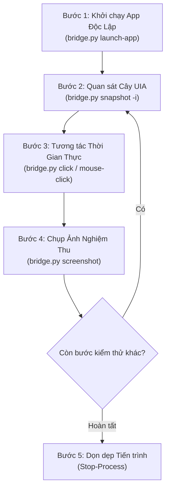

# Hướng Dẫn Kiểm Thử Tự Động Giao Diện Windows Bằng `agent-desktop` (`GUIDE.md`)

Tài liệu này là cẩm nang kỹ thuật chuẩn hóa dành cho AI Agent và nhà phát triển khi thực hiện kiểm thử tự động trực quan (Automated UI & Visual Verification) trên ứng dụng **Zenix** (nền tảng .NET 10 WinUI 3) bằng công cụ `agent-desktop`.

---

## 1. Tổng Quan Kiến Trúc & Nguyên Lý Hoạt Động

Quy trình kiểm thử tự động giao diện tuân thủ nghiêm ngặt **Hiến chương dự án (Principle VIII)** dựa trên sự kết hợp giữa 2 thành phần độc lập:

1. **Điều khiển & Tương tác (100% Native OS Accessibility CLI)**:
   - Sử dụng công cụ `agent-desktop` (từ Vercel Labs) giao tiếp trực tiếp với cây trợ năng **Windows UI Automation (UIA)** của nhân Windows.
   - Hoàn toàn **không dùng AI thị giác (Vision) hay OCR để đoán tọa độ**. Mọi điều khiển (`Button`, `TabItem`, `TreeItem`, `DataGrid`) đều được nhận diện chính xác qua định danh UIA và tọa độ hộp bao (`BoundingRectangle`) chuẩn xác từng pixel.
2. **Cổng Nghiệm Thu Trực Quan (Visual Verification Gate)**:
   - Ảnh chụp cửa sổ chất lượng cao (`agent-desktop screenshot`) được trích xuất trực tiếp từ bộ đệm đồ họa (DWM framebuffer) của Windows.
   - Agent phân tích hình ảnh độc lập để kiểm định chất lượng hiển thị thực tế (font chữ tiếng Việt, hiệu ứng Mica Fluent Design, chevron mũi tên `>`), ngăn ngừa tuyệt đối tình trạng nghiệm thu bằng suy đoán.

---

## 2. Rào Cản Sandbox Desktop Isolation & Cầu Nối `bridge.py`

### 2.1 Bản Chất Kỹ Thuật
Khi chạy lệnh terminal trong môi trường Agent Sandbox (Antigravity runner trên Windows):
- Hệ điều hành tự động cô lập tiến trình của Agent vào một Windows Desktop ảo tạm thời (ví dụ: `Desktop: exebox-...` thuộc trạm `WinSta0`).
- Do trên desktop ảo này không có bất kỳ cửa sổ giao diện nào, lệnh gọi `agent-desktop` trực tiếp sẽ sập với lỗi:
  ```json
  {"code":"INTERNAL","message":"EnumWindows failed to enumerate top-level windows"}
  ```
- Đồng thời, các tiến trình con được khởi tạo trực tiếp trong một lệnh terminal sẽ bị tự động đóng lại bởi cơ chế Job Object (`JOB_OBJECT_LIMIT_KILL_ON_JOB_CLOSE`) ngay khi lệnh terminal đó kết thúc.

### 2.2 Giải Pháp Cầu Nối Chuẩn Hóa (`bridge.py`)
Mọi tương tác UI và khởi chạy app mục tiêu bắt buộc phải đi qua script cầu nối:
**Đường dẫn**: `.agents/skills/agent-desktop/scripts/bridge.py`

- **Gắn Desktop `WinSta0\default`**: Script cấu hình cờ Win32 `STARTUPINFO.lpDesktop = @"WinSta0\default"` để điều hướng mọi lệnh `agent-desktop` sang đúng Desktop hiển thị của người dùng.
- **Tách Lập Khỏi Job Object (`launch-app`)**: Khi khởi chạy app, `bridge.py` sử dụng `Win32_Process.Create` (WMI CIM) để tạo tiến trình độc lập, giúp ứng dụng duy trì sống vĩnh viễn trên màn hình người dùng xuyên suốt toàn bộ phiên làm việc.

---

## 3. Quy Trình Kiểm Thử Liên Tục Thời Gian Thực (Continuous Live UI Testing)

> [!IMPORTANT]
> **Tuyệt đối không đóng/mở lại ứng dụng giữa các thao tác kiểm thử.** Ứng dụng chỉ cần khởi chạy một lần duy nhất, sau đó Agent thực thi liên tiếp các lệnh tương tác thời gian thực trên cùng một tiến trình đang mở.

### Quy Trình 5 Bước Chuẩn Hóa:



### Chi Tiết Từng Lệnh Thực Thi:

#### Bước 1: Khởi Chạy Ứng Dụng 1 Lần Duy Nhất
```bash
python .agents/skills/agent-desktop/scripts/bridge.py launch-app "src\Zenix\bin\x64\Debug\net10.0-windows10.0.26100.0\win-x64\Zenix.exe"
```
*Ghi chú: Lệnh trả về JSON chứa PID của ứng dụng trên `WinSta0\default` và kết thúc ngay, ứng dụng sẽ tiếp tục sống độc lập.*

#### Bước 2: Quan Sát Trạng Thái & Lấy Định Danh `@ref`
```bash
# Xem danh sách cửa sổ
python .agents/skills/agent-desktop/scripts/bridge.py list-windows --app Zenix.exe

# Đọc cây phân cấp UIA tương tác (interactive nodes)
python .agents/skills/agent-desktop/scripts/bridge.py snapshot -i --app Zenix.exe --compact
```

#### Bước 3: Tương Tác Trực Tiếp Lên Cửa Sổ Đang Mở
- **Click vào element có ref duy nhất**:
  ```bash
  # Trong PowerShell: BẮT BUỘC bọc @ref trong dấu nháy đơn
  python .agents/skills/agent-desktop/scripts/bridge.py click '@s3sw1vrhsdiy7z:e4'
  ```
- **Xử lý Twin Elements (`AMBIGUOUS_TARGET`) hoặc tọa độ cụ thể**:
  Khi hai phần tử có cùng cấu trúc/tên (như các thẻ card trang chủ, các node kết nối `ConnectionModel`), `agent-desktop` sẽ từ chối click headless để tránh click nhầm. Khi đó, sử dụng tọa độ tính từ hộp bao cửa sổ (`bounds`):
  ```bash
  # Click đơn tại tọa độ (X, Y)
  python .agents/skills/agent-desktop/scripts/bridge.py --headed mouse-click --xy 378,652

  # Double-click bung node hoặc mở phiên (count = 2)
  python .agents/skills/agent-desktop/scripts/bridge.py --headed mouse-click --count 2 --xy 223,527
  ```
- **Nhập văn bản vào ô tìm kiếm hoặc trường dữ liệu**:
  ```bash
  python .agents/skills/agent-desktop/scripts/bridge.py set-value '@ref_id' "localhost"
  ```

#### Bước 4: Chụp Ảnh Màn Hình Nghiệm Thu Trực Quan
```bash
python .agents/skills/agent-desktop/scripts/bridge.py screenshot --app Zenix.exe "C:\Users\huynh\.gemini\antigravity\brain\<conversation-id>\live_verification.png"
```

#### Bước 5: Dọn Dẹp Sau Khi Nghiệm Thu Hoàn Tất
Khi đã thu thập đầy đủ bằng chứng kiểm thử, kết thúc tiến trình:
```powershell
powershell -NoProfile -Command "Stop-Process -Name Zenix -Force -ErrorAction SilentlyContinue"
```

---

## 4. Các Bất Biến & Quy Tắc Cấm (Invariants & Anti-Patterns)

1. **Bảo toàn XAML sạch (Zero-AutomationId Invariant)**:
   - Nghiêm cấm tuyệt đối thêm các thuộc tính thử nghiệm tạm thời như `AutomationProperties.AutomationId` vào tệp XAML sản phẩm.
   - `agent-desktop` tự động phân giải điều khiển qua role (`Button`, `ComboBox`, `TreeItem`, `TabItem`), localized display names và snapshot topology.
2. **Quy tắc trích dẫn Ref trong PowerShell (PowerShell Ref Quoting Mandate)**:
   - Khi chạy lệnh trong PowerShell, **bắt buộc luôn bọc mọi ref trong dấu nháy đơn** (`'@s8f3k2p9:e1'`). Nếu viết trần `@token`, PowerShell sẽ hiểu là toán tử splatting và tự xóa mất tham số.
3. **Nghiêm cấm nghiệm thu suy đoán (Zero-Speculation Gate)**:
   - Mọi tính năng hay sửa lỗi liên quan đến UI chỉ được phép bàn giao khi đã có ảnh chụp màn hình thực tế từ `agent-desktop screenshot` chứng minh giao diện hoạt động chính xác.
