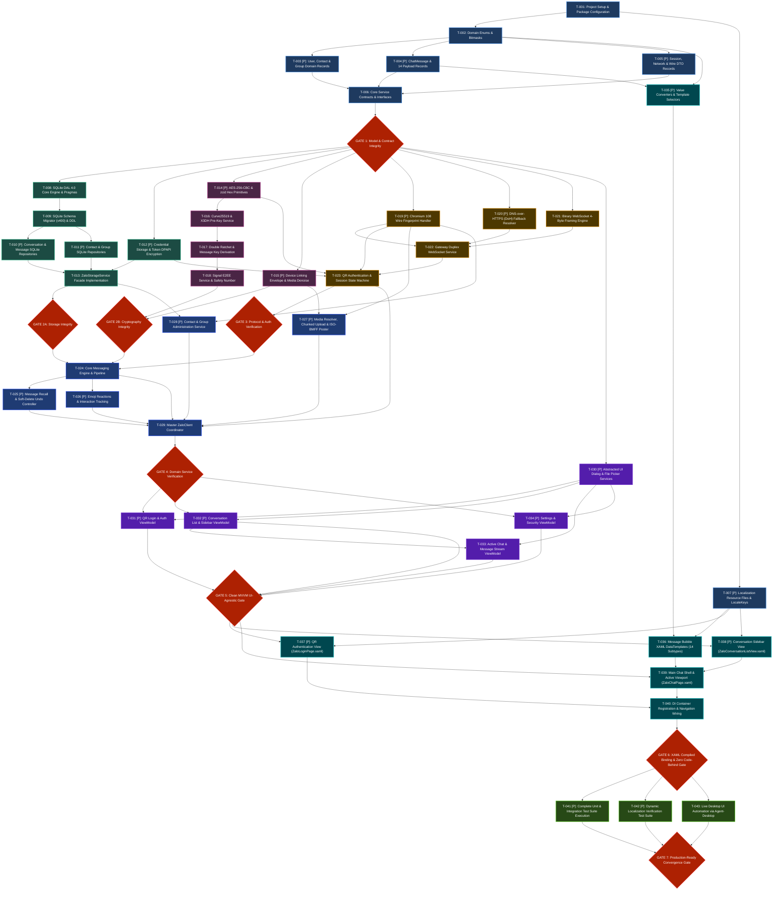

# Task Breakdown: Zalo Client Port to .NET 10 WinUI 3

**Feature Identifier**: `zalo-winui-port`  
**Phase**: Phase 3 Actionable Task Decomposition (`speckit-tasks`)  
**Date**: 2026-11-11  
**Status**: Approved (Production-Ready Architecture)  
**Spec Reference**: [.specify/specs/spec.md](spec.md)  
**Plan Reference**: [.specify/specs/plan.md](plan.md)  
**Research Reference**: [.specify/specs/research.md](research.md)  
**Data Model Reference**: [.specify/specs/data-model.md](data-model.md)  
**Contracts Reference**: [.specify/specs/contracts/service-interfaces.md](contracts/service-interfaces.md)  
**Quickstart Reference**: [.specify/specs/quickstart.md](quickstart.md)  
**Constitution Reference**: [.specify/memory/constitution.md](../memory/constitution.md)  

---

## 1. Executive Summary & Topological Ordering Overview

This document establishes the exhaustive, production-grade task breakdown for porting the reverse-engineered Zalo desktop messaging client (`zalo-swift-re` / Olaz) into the **Zenix** .NET 10 WinUI 3 modern desktop database and messaging environment.

The decomposition strictly adheres to the **Zenix Constitution (v1.19.0)**, **Spec-Kit**, and **GSS-Bridge** methodologies. Tasks are organized in a strict **topological dependency sequence**:
1. **Phase 1: Project Setup & Core Models / Contracts**: Foundational records, enums, DTOs, interface contracts, and dynamic localization resources.
2. **Phase 2: Core Infrastructure & Storage Services**: SQLite DAL 4.0, schema migrations, repositories, and DPAPI credential protection.
3. **Phase 3: Cryptography & Security Services**: Hardware-accelerated AES-256-CBC, KeychainCipher HKDF-SHA256, and Signal Protocol Double Ratchet E2EE.
4. **Phase 4: Network Transport & Authentication Services**: Chromium 108 wire fingerprinting, DoH DNS fallback, 4-byte binary WebSocket gateway, and multi-layer QR authentication.
5. **Phase 5: Messaging & Domain Business Services**: Message delivery pipeline (10 -> 1 -> 2 -> 3 -> 4), recall, undo grace periods, reactions, media uploads, and master `ZaloClient`.
6. **Phase 6: UI-Agnostic ViewModels & Presentation Logic**: Pure MVVM ViewModels, zero UI dependencies, `DispatcherQueue` marshalling, and abstracted dialog/file services.
7. **Phase 7: WinUI 3 Views, DataTemplates & Controls**: Pure XAML layouts, compiled `{x:Bind}`, zero code-behind visual manipulation, and dynamic `{Binding [Key], Source={StaticResource Localization}}`.
8. **Phase 8: Testing, Verification Gates & Agent Desktop Automation**: Unit/integration tests, localization audits, and live non-intrusive UI automation via `agent-desktop`.

Each task specifies:
- **Task ID**: Unique sequential identifier (`T-001` through `T-043`).
- **Parallel Eligibility**: `[P]` for tasks free of mutual file collisions and state dependencies; `[Sequential]` for dependency bottlenecks.
- **Dependencies**: Explicit list of prerequisite task IDs.
- **Scope & Files**: Input design artifacts and exact target code/test file paths.
- **Acceptance Criteria & Verification Command**: Executable verification via `dotnet test`, `dotnet build`, or `agent-desktop`.

---

## 2. Master Topological Dependency Diagram



---

## 3. Master Task Catalog by Phase

### Phase 1: Project Setup & Core Models / Contracts

#### [ ] Task 1: Project Setup & Package Configuration
- **Task ID**: `T-001`
- **Category**: Infrastructure & Tooling
- **Parallel Eligibility**: `[Sequential]`
- **Dependencies**: Prerequisites: None
- **Description**: Configure solution and project files for .NET 10 (`net10.0-windows10.0.26100.0`), LangVersion `preview`, and ensure required NuGet dependencies are referenced: `Microsoft.Data.Sqlite`, `CommunityToolkit.Mvvm` (8.4+), `WinUIEx` (2.5+), `Microsoft.Extensions.Hosting` (10.0+), and test harness packages (`xunit`, `Moq`, `FluentAssertions`). Enforce Roslyn rule `IDE0065` (using directives placed outside and above namespace) and Git CRLF line endings in `.editorconfig`.
- **Target Files**:
  - `Zenix/Zenix.csproj`
  - `tests/Zenix.Tests/Zenix.Tests.csproj`
  - `.editorconfig`
- **Verification Command / Acceptance Criteria**:
  ```powershell
  dotnet restore Zenix.sln
  dotnet build Zenix.sln -c Debug --no-restore
  ```
  - Project restores and builds cleanly with 0 errors and 0 warnings.
  - Target framework verified as `net10.0-windows10.0.26100.0`.

#### [ ] Task 2: Domain Enumerations & Bitmasks
- **Task ID**: `T-002`
- **Category**: Core Models
- **Parallel Eligibility**: `[Sequential]`
- **Dependencies**: Prerequisites: `T-001`
- **Description**: Implement strongly-typed domain enums in file-scoped namespace `Zenix.Core.Zalo.Models.Enums`: `MessageDeliveryStatus` (`Failed = -2, Sending = 10, Sent = 1, Delivered = 2, Seen = 3, SeenAll = 4`), `MessageKind` (`Text, Photo, Video, AudioVoice, FileAttachment, Sticker, Location, ContactCard, Poll, UndoDelete, Recalled, GroupSystemEvent, LinkPreview, CallLog`), `ChatConversationType` (`Direct = 0, Group = 1`), `GroupMemberRole` (`Member = 0, Admin = 1, Creator = 2`), `ZaloGender` (`Unknown = 0, Male = 1, Female = 2`), `QrScanState` (`Initial, ScannedWaitingConfirm, Approved, Expired, ErrorNegative20NeedsQr2`), and `NetworkConnectionState` (`Disconnected, Connecting, Connected, Reconnecting`).
- **Target Files**:
  - `Zenix/Core/Zalo/Models/Enums/MessageDeliveryStatus.cs`
  - `Zenix/Core/Zalo/Models/Enums/MessageKind.cs`
  - `Zenix/Core/Zalo/Models/Enums/ChatConversationType.cs`
  - `Zenix/Core/Zalo/Models/Enums/GroupMemberRole.cs`
  - `Zenix/Core/Zalo/Models/Enums/QrScanState.cs`
  - `Zenix/Core/Zalo/Models/Enums/NetworkConnectionState.cs`
- **Verification Command / Acceptance Criteria**:
  ```powershell
  dotnet build Zenix/Zenix.csproj -c Debug
  ```
  - 100% XML doc comments in technical American English.
  - Zero UI dependencies (`Microsoft.UI.Xaml.*`).
  - Integer enum mappings strictly match `data-model.md` and `spec.md`.

#### [ ] Task 3: User, Contact & Group Domain Records `[P]`
- **Task ID**: `T-003`
- **Category**: Core Models
- **Parallel Eligibility**: `[P]`
- **Dependencies**: Prerequisites: `T-002`
- **Description**: Implement immutable C# records in `Zenix.Core.Zalo.Models.Profiles`: `UserProfile` (user profile with `Initials` fallback helper), `UserContact` (address book contact with `EffectiveName`, `SortKey`, `SectionHeader`, `IsFriend`, `IsOfficialAccount`), `GroupProfile` (`GroupId`, `Name`, `CreatorId`, `MemberCount`, `IsCommunity`, `PinnedMsgId`), and `GroupMember` (`UserId`, `DisplayName`, `Role`, `JoinedAt`). All records use init-only properties and value equality.
- **Target Files**:
  - `Zenix/Core/Zalo/Models/Profiles/UserProfile.cs`
  - `Zenix/Core/Zalo/Models/Profiles/UserContact.cs`
  - `Zenix/Core/Zalo/Models/Profiles/GroupProfile.cs`
  - `Zenix/Core/Zalo/Models/Profiles/GroupMember.cs`
  - `Zenix/Core/Zalo/Helpers/ZaloStringHelper.cs`
- **Verification Command / Acceptance Criteria**:
  ```powershell
  dotnet test tests/Zenix.Tests/Zenix.Tests.csproj --filter "FullyQualifiedName~ProfileModelTests"
  ```
  - Unit tests confirm immutability, `Initials` calculation, and equality semantics.

#### [ ] Task 4: ChatMessage & 14 Payload Records `[P]`
- **Task ID**: `T-004`
- **Category**: Core Models
- **Parallel Eligibility**: `[P]`
- **Dependencies**: Prerequisites: `T-002`
- **Description**: Implement `ChatMessage` aggregate record and polymorphic `ChatMessagePayload` hierarchy with 14 concrete record subtypes: `TextPayload`, `PhotoPayload`, `VideoPayload`, `AudioVoicePayload`, `FileAttachmentPayload`, `StickerPayload`, `LocationPayload`, `ContactCardPayload`, `PollPayload`, `UndoDeletePayload`, `RecalledPayload`, `GroupSystemEventPayload`, `LinkPreviewPayload`, and `CallLogPayload`. Implement auxiliary records `MentionSpan` (`Uid`, `Pos`, `Len`), `MessageReaction` (`Emoji`, `Count`, `UserIds`), and `QuotedMessageSummary` (`MsgId`, `SenderName`, `Snippet`, `ThumbnailUrl`).
- **Target Files**:
  - `Zenix/Core/Zalo/Models/Messages/ChatMessage.cs`
  - `Zenix/Core/Zalo/Models/Messages/ChatMessagePayload.cs`
  - `Zenix/Core/Zalo/Models/Messages/Payloads/*.cs`
  - `Zenix/Core/Zalo/Models/Messages/MentionSpan.cs`
  - `Zenix/Core/Zalo/Models/Messages/MessageReaction.cs`
  - `Zenix/Core/Zalo/Models/Messages/QuotedMessageSummary.cs`
- **Verification Command / Acceptance Criteria**:
  ```powershell
  dotnet test tests/Zenix.Tests/Zenix.Tests.csproj --filter "FullyQualifiedName~MessagePayloadSerializationTests"
  ```
  - JSON polymorphic serialization roundtrips all 14 subtypes without data loss.

#### [ ] Task 5: Session, Network & Wire DTO Records `[P]`
- **Task ID**: `T-005`
- **Category**: Core Models & DTOs
- **Parallel Eligibility**: `[P]`
- **Dependencies**: Prerequisites: `T-002`
- **Description**: Implement wire DTO records in `Zenix.Core.Zalo.Models.Dto`: `QrCodeTokenResponse` (`qrToken`, `qrCodeUrl`, `expirySeconds`), `QrWaitScanResponse` (`status`, `errorCode`, `userId`, `avatar`, `displayName`), `LoginSessionCookie` (`zpwSek`, `encryptedToken`, `expiresAt`), `GatewayHandshakePayload`, `DohResolutionResult`, and `ZaloApiResponse<T>` (`errorCode`, `errorMessage`, `data`).
- **Target Files**:
  - `Zenix/Core/Zalo/Models/Dto/QrCodeTokenResponse.cs`
  - `Zenix/Core/Zalo/Models/Dto/QrWaitScanResponse.cs`
  - `Zenix/Core/Zalo/Models/Dto/LoginSessionCookie.cs`
  - `Zenix/Core/Zalo/Models/Dto/GatewayHandshakePayload.cs`
  - `Zenix/Core/Zalo/Models/Dto/DohResolutionResult.cs`
  - `Zenix/Core/Zalo/Models/Dto/ZaloApiResponse.cs`
- **Verification Command / Acceptance Criteria**:
  ```powershell
  dotnet test tests/Zenix.Tests/Zenix.Tests.csproj --filter "FullyQualifiedName~DtoSerializationTests"
  ```
  - DTOs deserialize sample JSON responses from Zalo PC 26.10 APIs successfully.

#### [ ] Task 6: Core Service Contracts & Interfaces
- **Task ID**: `T-006`
- **Category**: Architecture & DI Contracts
- **Parallel Eligibility**: `[Sequential]`
- **Dependencies**: Prerequisites: `T-003`, `T-004`, `T-005`
- **Description**: Author and integrate complete C# interface definitions into `Zenix.Core.Zalo.Contracts`: `IZaloClient`, `IZaloAuthService`, `IZaloGatewayService`, `IZaloCryptoService`, `IZaloMessageService`, `IZaloMediaService`, `IZaloContactService`, `IZaloStorageService`, `IFilePickerService`, `IDialogService`, `IChatViewModel`, and `IConversationListViewModel` conforming to `.specify/specs/contracts/`. Ensure 100% async methods accept `CancellationToken`, all using directives are above namespace (`IDE0065`), and no UI types (`UIElement`, `Window`) leak into service signatures.
- **Target Files**:
  - `Zenix/Core/Zalo/Contracts/IZaloClient.cs`
  - `Zenix/Core/Zalo/Contracts/IZaloAuthService.cs`
  - `Zenix/Core/Zalo/Contracts/IZaloGatewayService.cs`
  - `Zenix/Core/Zalo/Contracts/IZaloCryptoService.cs`
  - `Zenix/Core/Zalo/Contracts/IZaloMessageService.cs`
  - `Zenix/Core/Zalo/Contracts/IZaloMediaService.cs`
  - `Zenix/Core/Zalo/Contracts/IZaloContactService.cs`
  - `Zenix/Core/Zalo/Contracts/IZaloStorageService.cs`
  - `Zenix/Core/Zalo/Contracts/IFilePickerService.cs`
  - `Zenix/Core/Zalo/Contracts/IDialogService.cs`
  - `Zenix/Core/Zalo/Contracts/IChatViewModel.cs`
  - `Zenix/Core/Zalo/Contracts/IConversationListViewModel.cs`
- **Verification Command / Acceptance Criteria**:
  ```powershell
  dotnet build Zenix/Zenix.csproj -c Debug
  ```
  - Compilation passes cleanly.
  - Zero Roslyn `IDE0065` warnings.

#### [ ] Task 7: Localization Resource Files & LocaleKeys `[P]`
- **Task ID**: `T-007`
- **Category**: Localization & i18n
- **Parallel Eligibility**: `[P]`
- **Dependencies**: Prerequisites: `T-001`
- **Description**: Author and verify all user-facing localized string keys into `String.resx`, `String.en.resx`, and `String.vi.resx` located in `Zenix/Strings/`. Files must be saved in **UTF-8 without BOM** and CRLF line endings. Author `Zenix/Strings/LocaleKeys.cs` providing strongly-typed string constants. Ensure zero hardcoded English or Vietnamese literals in code or XAML.
- **Target Files**:
  - `Zenix/Strings/String.resx`
  - `Zenix/Strings/String.en.resx`
  - `Zenix/Strings/String.vi.resx`
  - `Zenix/Strings/LocaleKeys.cs`
- **Verification Command / Acceptance Criteria**:
  ```powershell
  dotnet test tests/Zenix.Tests/Zenix.Tests.csproj --filter "FullyQualifiedName~LocalizationVerificationTests"
  ```
  - Key parity verified: every key in `String.resx` exists in `String.en.resx` and `String.vi.resx`.
  - Zero orphan keys, zero BOM characters.

---

### Verification Gate 1: Model & Contract Integrity Gate
- **Enforcement**: Run full build and model tests.
- **Command**:
  ```powershell
  dotnet test tests/Zenix.Tests/Zenix.Tests.csproj --filter "Category=Models|Category=Contracts"
  ```
- **Criteria**: Zero compilation errors, zero warnings treated as errors, 100% XML doc comments in English, zero UI references in `Zenix.Core.Zalo.*`.

---

### Phase 2: Core Infrastructure & Storage Services

#### [ ] Task 8: SQLite DAL 4.0 Core Engine & Pragmas
- **Task ID**: `T-008`
- **Category**: Storage & Persistence
- **Parallel Eligibility**: `[Sequential]`
- **Dependencies**: Prerequisites: `T-006`
- **Description**: Implement `ZaloSqliteDalService` wrapping `Microsoft.Data.Sqlite` targeting `%LocalAppData%\Zenix\sqlite\_production\<account>\chat_storage.db`. Enforce mandatory pragmas on every connection open: `PRAGMA journal_mode = WAL; PRAGMA synchronous = NORMAL; PRAGMA busy_timeout = 5000; PRAGMA cache_size = -8000; PRAGMA foreign_keys = ON;`. Implement connection lease pool with `SemaphoreSlim` for serializing writes and non-blocking concurrent reads. Implement safe execution of `INSERT` statements encountering UNIQUE constraint conflicts returning `{ LastInsertedId = 0, RowsAffected = 0 }` instead of throwing fatal exceptions.
- **Target Files**:
  - `Zenix/Core/Zalo/Storage/ZaloSqliteDalService.cs`
  - `Zenix/Core/Zalo/Storage/SqliteExecutionResult.cs`
- **Verification Command / Acceptance Criteria**:
  ```powershell
  dotnet test tests/Zenix.Tests/Zenix.Tests.csproj --filter "FullyQualifiedName~ZaloSqliteDalTests"
  ```
  - WAL journal mode confirmed via `PRAGMA journal_mode;` returning `wal`.
  - UNIQUE constraint conflict handled without exception.

#### [ ] Task 9: SQLite Schema Migrator (v400) & DDL
- **Task ID**: `T-009`
- **Category**: Storage & Persistence
- **Parallel Eligibility**: `[Sequential]`
- **Dependencies**: Prerequisites: `T-008`
- **Description**: Implement `ZaloSqliteMigrator` executing schema initialization and migration handshakes. Manage `PRAGMA user_version = 400`. Create normalized tables according to `data-model.md`: `conversations` (with `id`, `type`, `name`, `pinned_msg_id`, `unread_count`, `last_updated_at`), `messages` (`cli_msg_id`, `msg_id`, `conv_id`, `sender_id`, `timestamp`, `offset`, `status`, `kind`, `payload_json`), `contacts`, `groups`, `group_members`, `drafts`, `keychain_keys`, and `sync_checkpoints`. Create performance indexes: `idx_messages_conv_ts (conv_id, timestamp DESC, offset DESC)`, `idx_messages_cli_id (cli_msg_id)`, and `idx_conv_updated (last_updated_at DESC)`.
- **Target Files**:
  - `Zenix/Core/Zalo/Storage/ZaloSqliteMigrator.cs`
  - `Zenix/Core/Zalo/Storage/Scripts/Schema_v400.sql`
- **Verification Command / Acceptance Criteria**:
  ```powershell
  dotnet test tests/Zenix.Tests/Zenix.Tests.csproj --filter "FullyQualifiedName~SqliteMigrationTests"
  ```
  - Migration cleanly transitions fresh database to version 400.
  - All tables and indexes verified via `sqlite_master`.

#### [ ] Task 10: Conversation & Message SQLite Repositories `[P]`
- **Task ID**: `T-010`
- **Category**: Storage Repositories
- **Parallel Eligibility**: `[P]`
- **Dependencies**: Prerequisites: `T-009`
- **Description**: Implement `ConversationRepository` and `MessageRepository` under `Zenix.Core.Zalo.Storage.Repositories`. `MessageRepository` must implement paginated message retrieval with stable sort tie-breaking by `(timestamp DESC, offset DESC)`, batch insert with parameterized statements, delivery status update (10 -> 1 -> 2 -> 3), recall mutation to `.recalled`, and draft persistence via `FailedDraftStore`.
- **Target Files**:
  - `Zenix/Core/Zalo/Storage/Repositories/ConversationRepository.cs`
  - `Zenix/Core/Zalo/Storage/Repositories/MessageRepository.cs`
  - `Zenix/Core/Zalo/Storage/Repositories/FailedDraftStore.cs`
- **Verification Command / Acceptance Criteria**:
  ```powershell
  dotnet test tests/Zenix.Tests/Zenix.Tests.csproj --filter "FullyQualifiedName~MessageRepositoryTests"
  ```
  - Pagination of 50 messages executes in $< 1.5\text{ ms}$.
  - Sort stability strictly verified under identical timestamps.

#### [ ] Task 11: Contact & Group SQLite Repositories `[P]`
- **Task ID**: `T-011`
- **Category**: Storage Repositories
- **Parallel Eligibility**: `[P]`
- **Dependencies**: Prerequisites: `T-009`
- **Description**: Implement `ContactRepository` and `GroupRepository` under `Zenix.Core.Zalo.Storage.Repositories`. Support contact upsert, friend list sync, alias updates, alphabetical section groupings (`#`, `A-Z`), group profile persistence, and group member role assignments (`Member`, `Admin`, `Creator`).
- **Target Files**:
  - `Zenix/Core/Zalo/Storage/Repositories/ContactRepository.cs`
  - `Zenix/Core/Zalo/Storage/Repositories/GroupRepository.cs`
- **Verification Command / Acceptance Criteria**:
  ```powershell
  dotnet test tests/Zenix.Tests/Zenix.Tests.csproj --filter "FullyQualifiedName~ContactRepositoryTests"
  ```
  - Contact grouping and alias search pass all assertions.

#### [ ] Task 12: Credential Storage & Token DPAPI Encryption `[P]`
- **Task ID**: `T-012`
- **Category**: Security & Credential Storage
- **Parallel Eligibility**: `[P]`
- **Dependencies**: Prerequisites: `T-006`
- **Description**: Implement `ZaloCredentialStorage` using Windows DPAPI / AES-256-GCM via Zenix's `PasswordEncryptor`. Safely persist session cookies (`zpw_sek`), device tokens, IMEI UUID, and Signal identity keys at rest in encrypted format. Ensure session cookies are scoped with domain prefix `.zalo.me`. Strictly scrub all credentials from error logs and crash dumps.
- **Target Files**:
  - `Zenix/Core/Zalo/Storage/ZaloCredentialStorage.cs`
- **Verification Command / Acceptance Criteria**:
  ```powershell
  dotnet test tests/Zenix.Tests/Zenix.Tests.csproj --filter "FullyQualifiedName~CredentialStorageTests"
  ```
  - Encrypted tokens decrypt successfully on the same Windows user context.
  - Raw strings never written to disk in unencrypted form.

#### [ ] Task 13: ZaloStorageService Facade Implementation
- **Task ID**: `T-013`
- **Category**: Storage Services
- **Parallel Eligibility**: `[Sequential]`
- **Dependencies**: Prerequisites: `T-010`, `T-011`, `T-012`
- **Description**: Implement `IZaloStorageService` facade aggregating `ZaloSqliteDalService`, `ConversationRepository`, `MessageRepository`, `ContactRepository`, `GroupRepository`, and `ZaloCredentialStorage`. Provide high-level transactional methods for full chat history sync, incremental updates, and account wipe operations.
- **Target Files**:
  - `Zenix/Core/Zalo/Storage/ZaloStorageService.cs`
- **Verification Command / Acceptance Criteria**:
  ```powershell
  dotnet test tests/Zenix.Tests/Zenix.Tests.csproj --filter "FullyQualifiedName~ZaloStorageServiceTests"
  ```
  - Full end-to-end repository sync operations pass cleanly.

---

### Verification Gate 2A: Storage Integrity Gate
- **Enforcement**: Run full storage test suite with in-memory and file-based SQLite tests.
- **Command**:
  ```powershell
  dotnet test tests/Zenix.Tests/Zenix.Tests.csproj --filter "Category=Storage"
  ```
- **Criteria**: Zero connection deadlocks, WAL active, migration to v400 verified, 50-message pagination latency $\le 1.5\text{ ms}$.

---

### Phase 3: Cryptography & Security Services

#### [ ] Task 14: AES-256-CBC & zcid Hex Primitives `[P]`
- **Task ID**: `T-014`
- **Category**: Cryptography
- **Parallel Eligibility**: `[P]`
- **Dependencies**: Prerequisites: `T-006`
- **Description**: Implement `ZaloCryptoService.cs` using `System.Security.Cryptography.Aes` with hardware acceleration. Implement `EncryptZcid` using fixed key `"3FC4F0D2AB50057BCE0D90D9187A22B1"`, zero IV (16 zero bytes), PKCS7 padding, and lowercase hex output format. Implement `EncryptApiParams` using fixed key `"DE71B7D4C57C0749158CB90D5E431AE3"`, zero IV, PKCS7 padding, and standard Base64 output format.
- **Target Files**:
  - `Zenix/Core/Zalo/Cryptography/ZaloCryptoService.cs`
- **Verification Command / Acceptance Criteria**:
  ```powershell
  dotnet test tests/Zenix.Tests/Zenix.Tests.csproj --filter "FullyQualifiedName~ZaloCryptoTests.VerifyZcidAndParamEncryption"
  ```
  - Output matches exact test vectors from `zalo-swift-re` `RuntimeTests.swift`.

#### [ ] Task 15: Device Linking Envelope & Media De-noising `[P]`
- **Task ID**: `T-015`
- **Category**: Cryptography
- **Parallel Eligibility**: `[P]`
- **Dependencies**: Prerequisites: `T-006`
- **Description**: Implement `ZaloCryptoService.Keychain.cs`. Implement trusted device linking envelope packing/unpacking: format `[version: 1B = 0x49][iv: 16B][salt: 16B][ciphertext: NB][hmac: 32B]`. Derive encryption and MAC keys using HKDF-SHA256 (`info = "ZaloDeviceLink"`). Enforce constant-time HMAC-SHA256 verification using `CryptographicOperations.FixedTimeEquals`. Implement `DenoiseMedia` applying byte-wise XOR `147` against payload containing anti-scraping signature `077a416c4f07`.
- **Target Files**:
  - `Zenix/Core/Zalo/Cryptography/ZaloCryptoService.Keychain.cs`
  - `Zenix/Core/Zalo/Cryptography/MediaDenoiseHelper.cs`
- **Verification Command / Acceptance Criteria**:
  ```powershell
  dotnet test tests/Zenix.Tests/Zenix.Tests.csproj --filter "FullyQualifiedName~ZaloCryptoTests.VerifyKeychainAndDenoise"
  ```
  - Envelope roundtrip encrypts and decrypts accurately.
  - Constant-time comparison rejects tampered HMAC.
  - XOR 147 media de-noising successfully unpacks test image buffer.

#### [ ] Task 16: Curve25519 & X3DH Pre-Key Service
- **Task ID**: `T-016`
- **Category**: Cryptography & Signal Protocol
- **Parallel Eligibility**: `[Sequential]`
- **Dependencies**: Prerequisites: `T-014`
- **Description**: Implement Curve25519 Montgomery ladder key agreements and X3DH (Extended Triple Diffie-Hellman) pre-key bundle management in `SignalX3dhService`. Generate identity keys, signed prekeys with Curve25519 signatures, and batches of one-time prekeys. Compute master shared secret `SK = KDF(DH1 || DH2 || DH3 || DH4)`.
- **Target Files**:
  - `Zenix/Core/Zalo/Cryptography/SignalX3dhService.cs`
  - `Zenix/Core/Zalo/Cryptography/Curve25519Helper.cs`
- **Verification Command / Acceptance Criteria**:
  ```powershell
  dotnet test tests/Zenix.Tests/Zenix.Tests.csproj --filter "FullyQualifiedName~SignalX3dhTests"
  ```
  - X3DH shared secrets generated by Alice and Bob match identically.

#### [ ] Task 17: Double Ratchet & Message Key Derivation
- **Task ID**: `T-017`
- **Category**: Cryptography & Signal Protocol
- **Parallel Eligibility**: `[Sequential]`
- **Dependencies**: Prerequisites: `T-016`
- **Description**: Implement the Double Ratchet cryptographic engine in `SignalDoubleRatchetService`. Combine symmetric KDF chains (sending and receiving chains) with asymmetric Diffie-Hellman ratchet steps. Support skipped message keys table with time-to-live expiration to decrypt out-of-order packets safely without compromising forward secrecy.
- **Target Files**:
  - `Zenix/Core/Zalo/Cryptography/SignalDoubleRatchetService.cs`
  - `Zenix/Core/Zalo/Cryptography/DoubleRatchetSessionState.cs`
- **Verification Command / Acceptance Criteria**:
  ```powershell
  dotnet test tests/Zenix.Tests/Zenix.Tests.csproj --filter "FullyQualifiedName~DoubleRatchetTests"
  ```
  - 100 sequential ratchet steps simulate send/receive and out-of-order packet delivery without decryption failure.

#### [ ] Task 18: Signal E2EE Service & Safety Number Formatter
- **Task ID**: `T-018`
- **Category**: Cryptography & Signal Protocol
- **Parallel Eligibility**: `[Sequential]`
- **Dependencies**: Prerequisites: `T-017`
- **Description**: Implement `SignalE2eeService` implementing `ISignalE2eeService`. Support serialization and deserialization of Type 3 (`PreKeyWhisperMessage`) and Type 1 (`WhisperMessage`) envelopes. Implement 60-digit Safety Number calculation: sort user identity keys, compute SHA-512 iteration loop, extract 32-bit big-endian integers modulo 100,000, and format into 12 groups of 5 decimal digits (e.g. `12345 67890 ...`).
- **Target Files**:
  - `Zenix/Core/Zalo/Cryptography/SignalE2eeService.cs`
  - `Zenix/Core/Zalo/Cryptography/SafetyNumberFormatter.cs`
- **Verification Command / Acceptance Criteria**:
  ```powershell
  dotnet test tests/Zenix.Tests/Zenix.Tests.csproj --filter "FullyQualifiedName~SignalE2eeTests"
  ```
  - Safety Number formatting matches reference test vector format.
  - End-to-end encryption/decryption of sample text passes.

---

### Verification Gate 2B: Cryptography Integrity Gate
- **Enforcement**: Run full cryptographic unit test suite.
- **Command**:
  ```powershell
  dotnet test tests/Zenix.Tests/Zenix.Tests.csproj --filter "Category=Crypto"
  ```
- **Criteria**: 100% test vectors pass, constant-time HMAC check verified, zero managed memory leakage of plaintext keys.

---

### Phase 4: Network Transport & Authentication Services

#### [ ] Task 19: Chromium 108 Wire Fingerprint Handler `[P]`
- **Task ID**: `T-019`
- **Category**: Network & REST Transport
- **Parallel Eligibility**: `[P]`
- **Dependencies**: Prerequisites: `T-006`
- **Description**: Implement `ZaloWireFingerprintHandler` deriving from `DelegatingHandler`. Inject Chromium 108 wire headers: `User-Agent: ZaloPC-win32-23v694`, `sec-ch-ua: "Not?A_Brand";v="8", "Chromium";v="108"`, `sec-ch-ua-mobile: ?0`, `sec-ch-ua-platform: "Windows"`, `sec-fetch-dest: empty`, `sec-fetch-mode: cors`, `sec-fetch-site: same-origin`. Automatically strip `Origin` and `Referer` headers on outbound REST calls. Attach `zpw_sek` session cookie into request headers.
- **Target Files**:
  - `Zenix/Core/Zalo/Network/ZaloWireFingerprintHandler.cs`
- **Verification Command / Acceptance Criteria**:
  ```powershell
  dotnet test tests/Zenix.Tests/Zenix.Tests.csproj --filter "FullyQualifiedName~WireFingerprintHandlerTests"
  ```
  - Mock HTTP pipeline asserts presence of exact Chromium headers and absence of stripped headers.

#### [ ] Task 20: DNS-over-HTTPS (DoH) Fallback Resolver `[P]`
- **Task ID**: `T-020`
- **Category**: Network & DNS
- **Parallel Eligibility**: `[P]`
- **Dependencies**: Prerequisites: `T-006`
- **Description**: Implement `DohResolverService` querying Google DNS-over-HTTPS endpoint (`https://dns.google/resolve?name={host}&type=A`). When standard Windows WinSock DNS resolution fails or encounters ISP routing blocks, query DoH over HTTPS, cache IP results for the TTL duration, and route subsequent HTTP/WebSocket traffic directly to resolved IPs.
- **Target Files**:
  - `Zenix/Core/Zalo/Network/DohResolverService.cs`
- **Verification Command / Acceptance Criteria**:
  ```powershell
  dotnet test tests/Zenix.Tests/Zenix.Tests.csproj --filter "FullyQualifiedName~DohResolverTests"
  ```
  - DoH resolver successfully resolves `chat.zalo.me` IPv4 A-records from Google DoH endpoint.

#### [ ] Task 21: Binary WebSocket 4-Byte Framing Engine
- **Task ID**: `T-021`
- **Category**: Realtime Protocol & Binary Framing
- **Parallel Eligibility**: `[Sequential]`
- **Dependencies**: Prerequisites: `T-006`
- **Description**: Implement `ZaloGatewayFraming.cs` managing 4-byte binary packet headers: `[version: 1B][cmd: 2B Little-Endian][subCmd: 1B][Payload: NB]`. Utilize `ReadOnlySpan<byte>` and `Memory<byte>` for zero-allocation slicing. Implement packet serializer formatting outbound messages and packet parser decoding inbound frames. Provide command mappings according to `spec.md § 6.2`.
- **Target Files**:
  - `Zenix/Core/Zalo/Network/ZaloGatewayFraming.cs`
  - `Zenix/Core/Zalo/Network/GatewayPacket.cs`
- **Verification Command / Acceptance Criteria**:
  ```powershell
  dotnet test tests/Zenix.Tests/Zenix.Tests.csproj --filter "FullyQualifiedName~ZaloGatewayFramingTests"
  ```
  - Benchmark assertions prove 0 heap bytes allocated during header parse.
  - Little-endian 16-bit command codes decode accurately.

#### [ ] Task 22: Gateway Duplex WebSocket Service
- **Task ID**: `T-022`
- **Category**: Realtime Protocol
- **Parallel Eligibility**: `[Sequential]`
- **Dependencies**: Prerequisites: `T-019`, `T-021`, `T-020`
- **Description**: Implement `ZaloGatewayService` implementing `IZaloGatewayService`. Manage persistent `System.Net.WebSockets.ClientWebSocket` connected to `wss://wsN-msg.chat.zalo.me` (where `N` is assigned by auth service). Implement background read loop, heartbeat ping timer (interval 30s), exponential backoff reconnection with jitter (1s, 2s, 4s, 8s, up to 30s max), and thread-safe sending queue via `Channel<GatewayPacket>`.
- **Target Files**:
  - `Zenix/Core/Zalo/Network/ZaloGatewayService.cs`
- **Verification Command / Acceptance Criteria**:
  ```powershell
  dotnet test tests/Zenix.Tests/Zenix.Tests.csproj --filter "FullyQualifiedName~ZaloGatewayServiceTests"
  ```
  - Mock WebSocket server receives framed ping packets and verifies reconnection backoff.

#### [ ] Task 23: QR Authentication & Session State Machine
- **Task ID**: `T-023`
- **Category**: Authentication & Session Lifecycle
- **Parallel Eligibility**: `[Sequential]`
- **Dependencies**: Prerequisites: `T-012`, `T-014`, `T-019`, `T-022`
- **Description**: Implement `ZaloAuthService` implementing `IZaloAuthService`. Generate device IMEI (`z_uuid`) using GUID format. Implement `reqqr` requesting initial QR token. Implement `chkWaitScan` polling loop. When server responds with `error_code: -20`, seamlessly trigger second QR scan (`qr2`) without presenting an error dialog. On approval, extract session cookie `zpw_sek`, encrypt with `ZaloCredentialStorage`, transition `QrScanState` to `Approved`, and register single-session kickout listener on `/api/session/kickout-info`.
- **Target Files**:
  - `Zenix/Core/Zalo/Services/ZaloAuthService.cs`
- **Verification Command / Acceptance Criteria**:
  ```powershell
  dotnet test tests/Zenix.Tests/Zenix.Tests.csproj --filter "FullyQualifiedName~ZaloAuthServiceTests"
  ```
  - State machine transitions correctly through Initial -> Scanned -> Approved.
  - `-20` error initiates QR2 flow automatically.

---

### Verification Gate 3: Protocol & Service Verification Gate
- **Enforcement**: Run Network and Auth test suites.
- **Command**:
  ```powershell
  dotnet test tests/Zenix.Tests/Zenix.Tests.csproj --filter "Category=Network|Category=Auth"
  ```
- **Criteria**: Zero-allocation binary framing verified, WebSocket reconnect verified, QR state machine verified.

---

### Phase 5: Messaging & Domain Business Services

#### [ ] Task 24: Core Messaging Engine & Delivery Pipeline
- **Task ID**: `T-024`
- **Category**: Messaging Engine
- **Parallel Eligibility**: `[Sequential]`
- **Dependencies**: Prerequisites: `T-013`, `T-018`, `T-022`
- **Description**: Implement `ZaloMessageService` implementing `IZaloMessageService`. Manage message transmission lifecycle: create local optimistic message with `cliMsgId` in status `10 (Sending)`, dispatch through `ZaloGatewayService`, handle server ACK updating status to `1 (Sent)` and setting server `msgId`. Parse mention spans and rebase character offsets after whitespace trimming. Support quote replies by attaching `QuotedMessageSummary`. Manage `FailedDraftStore` ensuring failed sends preserve text drafts.
- **Target Files**:
  - `Zenix/Core/Zalo/Services/ZaloMessageService.cs`
  - `Zenix/Core/Zalo/Helpers/MentionParser.cs`
- **Verification Command / Acceptance Criteria**:
  ```powershell
  dotnet test tests/Zenix.Tests/Zenix.Tests.csproj --filter "FullyQualifiedName~ZaloMessageServiceTests"
  ```
  - Status progression 10 -> 1 -> 2 -> 3 confirmed via events.
  - Mention offsets accurately align with target display name in message text.

#### [ ] Task 25: Message Recall, Soft-Delete & Undo Controller `[P]`
- **Task ID**: `T-025`
- **Category**: Messaging Engine
- **Parallel Eligibility**: `[P]`
- **Dependencies**: Prerequisites: `T-024`
- **Description**: Implement `ZaloMessageLifecycleService.cs`. Handle message recall within allowable time limit (emitting server command and locally mutating message kind to `.recalled`). Implement local soft-delete ("Xóa chỉ ở phía tôi") with a 5-to-30-second configurable undo grace period timer. If user clicks "Khôi phục" before timer expiration, cancel database soft-delete; otherwise permanently flag message as locally deleted.
- **Target Files**:
  - `Zenix/Core/Zalo/Services/ZaloMessageLifecycleService.cs`
- **Verification Command / Acceptance Criteria**:
  ```powershell
  dotnet test tests/Zenix.Tests/Zenix.Tests.csproj --filter "FullyQualifiedName~MessageLifecycleTests"
  ```
  - Recall replaces message payload with `RecalledPayload`.
  - Undo restores message state before timer deadline.

#### [ ] Task 26: Emoji Reactions & Interaction Tracking `[P]`
- **Task ID**: `T-026`
- **Category**: Messaging Engine
- **Parallel Eligibility**: `[P]`
- **Dependencies**: Prerequisites: `T-024`
- **Description**: Implement `ZaloReactionService.cs`. Handle emoji reactions on messages (e.g. Heart, Like, Haha, Wow, Sad, Angry). Enforce Zalo reaction rules: multiple clicks by the same user stack without toggling off. Aggregate reaction counts per emoji type and maintain user ID lists for tooltip display.
- **Target Files**:
  - `Zenix/Core/Zalo/Services/ZaloReactionService.cs`
- **Verification Command / Acceptance Criteria**:
  ```powershell
  dotnet test tests/Zenix.Tests/Zenix.Tests.csproj --filter "FullyQualifiedName~ReactionServiceTests"
  ```
  - Reaction stacking semantics validated: successive clicks increment count.

#### [ ] Task 27: Media Resolver, Chunked Upload & ISO-BMFF Poster `[P]`
- **Task ID**: `T-027`
- **Category**: Media Services
- **Parallel Eligibility**: `[P]`
- **Dependencies**: Prerequisites: `T-015`, `T-019`
- **Description**: Implement `ZaloMediaService` implementing `IZaloMediaService`. Implement multipart upload strictly adhering to `----WebKitFormBoundary[16 alphanumeric chars]`. Manage download scheduler throttling to a maximum of 3 concurrent active downloads using a LIFO priority queue for viewport-visible images. Implement ISO-BMFF container detection by scanning for `ftyp` box at byte offset 4 for MP4/MOV videos, extracting first-frame thumbnail and saving as `.poster.jpg`.
- **Target Files**:
  - `Zenix/Core/Zalo/Services/ZaloMediaService.cs`
  - `Zenix/Core/Zalo/Helpers/IsoBmffDetector.cs`
- **Verification Command / Acceptance Criteria**:
  ```powershell
  dotnet test tests/Zenix.Tests/Zenix.Tests.csproj --filter "FullyQualifiedName~ZaloMediaServiceTests"
  ```
  - Multipart boundary format matches WebKit regex.
  - Concurrency throttle holds at max 3 simultaneous HTTP transfers.
  - Video poster extracted from test ISO-BMFF stream.

#### [ ] Task 28: Contact & Group Administration Service `[P]`
- **Task ID**: `T-028`
- **Category**: Domain Services
- **Parallel Eligibility**: `[P]`
- **Dependencies**: Prerequisites: `T-013`, `T-019`
- **Description**: Implement `ZaloContactService` implementing `IZaloContactService`. Synchronize address book contacts, fetch detailed user profiles, manage group member listings, handle admin promotions/demotions, support group invitation links, and implement high-performance in-memory search with Vietnamese diacritic-insensitive matching.
- **Target Files**:
  - `Zenix/Core/Zalo/Services/ZaloContactService.cs`
  - `Zenix/Core/Zalo/Helpers/VietnameseSearchHelper.cs`
- **Verification Command / Acceptance Criteria**:
  ```powershell
  dotnet test tests/Zenix.Tests/Zenix.Tests.csproj --filter "FullyQualifiedName~ZaloContactServiceTests"
  ```
  - Diacritic-insensitive search matches "Nguyen" against "Nguyễn".

#### [ ] Task 29: Master ZaloClient Coordinator
- **Task ID**: `T-029`
- **Category**: Master Domain Coordinator
- **Parallel Eligibility**: `[Sequential]`
- **Dependencies**: Prerequisites: `T-023`, `T-024`, `T-025`, `T-026`, `T-027`, `T-028`
- **Description**: Implement `ZaloClient` implementing `IZaloClient`. Coordinate the complete client lifecycle: aggregate `Auth`, `Gateway`, `Messages`, `Contacts`, `Media`, `Crypto`, and `Storage`. Expose unified events (`MessageReceived`, `ConversationUpdated`, `KickoutReceived`, `ConnectionStateChanged`). Manage clean disconnect and disposal of all background resources.
- **Target Files**:
  - `Zenix/Core/Zalo/Services/ZaloClient.cs`
- **Verification Command / Acceptance Criteria**:
  ```powershell
  dotnet test tests/Zenix.Tests/Zenix.Tests.csproj --filter "FullyQualifiedName~ZaloClientTests"
  ```
  - Unified client orchestrates mock login, message reception, and orderly shutdown.

---

### Verification Gate 4: Domain Service Verification Gate
- **Enforcement**: Run full domain services test suite.
- **Command**:
  ```powershell
  dotnet test tests/Zenix.Tests/Zenix.Tests.csproj --filter "Category=Services"
  ```
- **Criteria**: All business workflows pass, mention offsets align, media scheduler throttles at 3, and client coordinates lifecycle cleanly.

---

### Phase 6: UI-Agnostic ViewModels & Presentation Logic

#### [ ] Task 30: Abstracted UI Dialog & File Picker Services `[P]`
- **Task ID**: `T-030`
- **Category**: Presentation Infrastructure
- **Parallel Eligibility**: `[P]`
- **Dependencies**: Prerequisites: `T-006`
- **Description**: Implement `WinUIDialogService` and `WinUIFilePickerService` implementing `IDialogService` and `IFilePickerService`. Encapsulate WinUI 3 `ContentDialog` (resolving current window `XamlRoot`), `InfoBar` toasts, and Windows Storage pickers (`FileOpenPicker`, `FileSavePicker`) behind UI-agnostic interfaces so ViewModels remain 100% free of UIElement references.
- **Target Files**:
  - `Zenix/Services/WinUIDialogService.cs`
  - `Zenix/Services/WinUIFilePickerService.cs`
- **Verification Command / Acceptance Criteria**:
  ```powershell
  dotnet test tests/Zenix.Tests/Zenix.Tests.csproj --filter "FullyQualifiedName~DialogServiceTests"
  ```
  - Mock dialog and file picker services allow ViewModels to be unit tested headlessly.

#### [ ] Task 31: QR Login & Auth ViewModel `[P]`
- **Task ID**: `T-031`
- **Category**: ViewModels
- **Parallel Eligibility**: `[P]`
- **Dependencies**: Prerequisites: `T-023`, `T-030`
- **Description**: Implement `ZaloLoginViewModel` deriving from `ObservableObject`. Use `[ObservableProperty]` for `QrCodeImageBytes`, `ScanState`, `CountdownSeconds`, `UserAvatarUrl`, `UserDisplayName`, and `IsLoading`. Use `[RelayCommand]` for `RefreshQrCommand`, `CancelLoginCommand`, and `SwitchAccountCommand`. UI thread updates must be marshalled through `DispatcherQueue.TryEnqueue`. 100% UI-agnostic.
- **Target Files**:
  - `Zenix/ViewModels/Zalo/ZaloLoginViewModel.cs`
- **Verification Command / Acceptance Criteria**:
  ```powershell
  dotnet test tests/Zenix.Tests/Zenix.Tests.csproj --filter "FullyQualifiedName~ZaloLoginViewModelTests"
  ```
  - Unit tests verify QR refresh command, timeout countdown timer, and navigation on approval.

#### [ ] Task 32: Conversation List & Sidebar ViewModel `[P]`
- **Task ID**: `T-032`
- **Category**: ViewModels
- **Parallel Eligibility**: `[P]`
- **Dependencies**: Prerequisites: `T-029`, `T-030`
- **Description**: Implement `ZaloConversationListViewModel` implementing `IConversationListViewModel`. Derive from `ObservableObject`. Expose `ObservableCollection<ConversationSummaryItemViewModel> Conversations`, `ConversationSummaryItemViewModel? SelectedConversation`, `string SearchQuery`, and `int TotalUnreadCount`. Use `[RelayCommand]` for `SelectConversationCommand`, `PinConversationCommand`, `MuteConversationCommand`, and `ArchiveConversationCommand`.
- **Target Files**:
  - `Zenix/ViewModels/Zalo/ZaloConversationListViewModel.cs`
  - `Zenix/ViewModels/Zalo/ConversationSummaryItemViewModel.cs`
- **Verification Command / Acceptance Criteria**:
  ```powershell
  dotnet test tests/Zenix.Tests/Zenix.Tests.csproj --filter "FullyQualifiedName~ConversationListViewModelTests"
  ```
  - Filtering search query updates visible conversation collection instantly.
  - Pinning conversation repositions item to top of list.

#### [ ] Task 33: Active Chat & Message Stream ViewModel
- **Task ID**: `T-033`
- **Category**: ViewModels
- **Parallel Eligibility**: `[Sequential]`
- **Dependencies**: Prerequisites: `T-029`, `T-030`, `T-032`
- **Description**: Implement `ZaloChatViewModel` implementing `IChatViewModel`. Derive from `ObservableObject`. Expose `ObservableCollection<ChatMessageItemViewModel> Messages`, `string ComposerText`, `QuotedMessageSummary? ActiveQuoteReply`, `bool IsMentionFlyoutOpen`, and `ObservableCollection<UserContact> FilteredMentions`. Use `[RelayCommand]` for `SendMessageCommand`, `SendMediaAttachmentCommand`, `ReplyCommand`, `RecallMessageCommand`, `DeleteForMeCommand`, `UndoDeleteCommand`, and `ReactCommand`. Marshall all incoming message appends through `DispatcherQueue.TryEnqueue`.
- **Target Files**:
  - `Zenix/ViewModels/Zalo/ZaloChatViewModel.cs`
  - `Zenix/ViewModels/Zalo/ChatMessageItemViewModel.cs`
- **Verification Command / Acceptance Criteria**:
  ```powershell
  dotnet test tests/Zenix.Tests/Zenix.Tests.csproj --filter "FullyQualifiedName~ZaloChatViewModelTests"
  ```
  - Sending message immediately adds item in `Sending` state and invokes service.
  - Reply command sets `ActiveQuoteReply` property.

#### [ ] Task 34: Settings & Security ViewModel `[P]`
- **Task ID**: `T-034`
- **Category**: ViewModels
- **Parallel Eligibility**: `[P]`
- **Dependencies**: Prerequisites: `T-029`, `T-030`
- **Description**: Implement `ZaloSettingsViewModel` deriving from `ObservableObject`. Manage user security settings: Safety Number verification dialog inspection, auto-download media toggles, local chat storage cache size calculation, cache clearance command, and logout / account wipe command.
- **Target Files**:
  - `Zenix/ViewModels/Zalo/ZaloSettingsViewModel.cs`
- **Verification Command / Acceptance Criteria**:
  ```powershell
  dotnet test tests/Zenix.Tests/Zenix.Tests.csproj --filter "FullyQualifiedName~ZaloSettingsViewModelTests"
  ```
  - Cache clearance invokes storage service and updates displayed size to 0 bytes.

---

### Verification Gate 5: Clean MVVM UI-Agnostic ViewModel Gate
- **Enforcement**: Run Roslyn architecture verification tests.
- **Command**:
  ```powershell
  dotnet test tests/Zenix.Tests/Zenix.Tests.csproj --filter "Category=MvvmCompliance"
  ```
- **Criteria**: Zero references to `Microsoft.UI.Xaml.*` in `Zenix/ViewModels/Zalo/`, all commands derive from `IRelayCommand`, all properties notify property changes.

---

### Phase 7: WinUI 3 Views, DataTemplates & Controls

#### [ ] Task 35: Value Converters & Template Selectors `[P]`
- **Task ID**: `T-035`
- **Category**: XAML Presentation Controls
- **Parallel Eligibility**: `[P]`
- **Dependencies**: Prerequisites: `T-002`, `T-004`
- **Description**: Implement WinUI 3 converters and template selectors in `Zenix/Converters/Zalo/`: `DeliveryStatusToIconConverter` (mapping `MessageDeliveryStatus` to Fluent Symbol/Glyph), `TimestampToRelativeStringConverter` (formatting timestamps relative to now), `ReactionCountConverter`, `InitialsAvatarColorConverter`, and `MessageBubbleTemplateSelector` (selecting the appropriate `DataTemplate` among the 14 message kinds).
- **Target Files**:
  - `Zenix/Converters/Zalo/DeliveryStatusToIconConverter.cs`
  - `Zenix/Converters/Zalo/TimestampToRelativeStringConverter.cs`
  - `Zenix/Converters/Zalo/MessageBubbleTemplateSelector.cs`
  - `Zenix/Converters/Zalo/ReactionCountConverter.cs`
  - `Zenix/Converters/Zalo/InitialsAvatarColorConverter.cs`
- **Verification Command / Acceptance Criteria**:
  ```powershell
  dotnet test tests/Zenix.Tests/Zenix.Tests.csproj --filter "FullyQualifiedName~ConverterTests"
  ```
  - Converters return expected symbols and formatted strings for all boundary states.

#### [ ] Task 36: Message Bubble XAML DataTemplates (14 Subtypes)
- **Task ID**: `T-036`
- **Category**: XAML Controls & Templates
- **Parallel Eligibility**: `[Sequential]`
- **Dependencies**: Prerequisites: `T-007`, `T-035`
- **Description**: Author `MessageBubbleTemplates.xaml` ResourceDictionary containing clean WinUI 3 `DataTemplate` declarations for all 14 message payload kinds: text (with inline hyperlink and mention highlights), photo grids, video player previews, audio voice waveforms, file attachments (with file icon and download progress bar), stickers, locations, quotes, and recalled notices. Strictly enforce: 100% `{x:Bind}` compiled bindings for ViewModel properties; 100% dynamic localization indexer `{Binding [Key], Source={StaticResource Localization}}` for text labels; zero hardcoded raw string literals; context menus (`MenuFlyout`) declared purely in XAML binding to RelayCommands.
- **Target Files**:
  - `Zenix/Views/Zalo/Templates/MessageBubbleTemplates.xaml`
- **Verification Command / Acceptance Criteria**:
  ```powershell
  dotnet build Zenix/Zenix.csproj -c Debug
  ```
  - XAML compiles cleanly with compiled `{x:Bind}` validation.
  - Zero hardcoded user strings detected in XAML.

#### [ ] Task 37: QR Authentication View (ZaloLoginPage.xaml) `[P]`
- **Task ID**: `T-037`
- **Category**: WinUI 3 Views
- **Parallel Eligibility**: `[P]`
- **Dependencies**: Prerequisites: `T-007`, `T-031`
- **Description**: Create `ZaloLoginPage.xaml` and code-behind `ZaloLoginPage.xaml.cs`. Bind `ViewModel` via constructor injection or DI resolver. Render QR code image, animated scan line effect, expiry countdown progress ring, avatar confirm card when scanned, and switch account button. Strictly enforce: code-behind contains ZERO business logic and ZERO UI element manipulation; all state transitions bound through XAML.
- **Target Files**:
  - `Zenix/Views/Zalo/ZaloLoginPage.xaml`
  - `Zenix/Views/Zalo/ZaloLoginPage.xaml.cs`
- **Verification Command / Acceptance Criteria**:
  ```powershell
  dotnet build Zenix/Zenix.csproj -c Debug
  ```
  - XAML compiled successfully with `{x:Bind}`. Code-behind contains only `InitializeComponent()`.

#### [ ] Task 38: Conversation Sidebar View (ZaloConversationListView.xaml) `[P]`
- **Task ID**: `T-038`
- **Category**: WinUI 3 Views
- **Parallel Eligibility**: `[P]`
- **Dependencies**: Prerequisites: `T-007`, `T-032`
- **Description**: Create `ZaloConversationListView.xaml` and `ZaloConversationListView.xaml.cs`. Implement virtualized `ListView` for smooth scrolling of 1,000+ threads. Display contact/group avatar (with initials fallback), thread title, snippet, relative timestamp, unread badge, and pin icon. Declare item context menu purely in XAML for Pin, Mute, and Delete actions bound to ViewModel commands.
- **Target Files**:
  - `Zenix/Views/Zalo/ZaloConversationListView.xaml`
  - `Zenix/Views/Zalo/ZaloConversationListView.xaml.cs`
- **Verification Command / Acceptance Criteria**:
  ```powershell
  dotnet build Zenix/Zenix.csproj -c Debug
  ```
  - XAML builds cleanly with compiled bindings. Virtualization confirmed active.

#### [ ] Task 39: Main Chat Shell & Active Viewport (ZaloChatPage.xaml)
- **Task ID**: `T-039`
- **Category**: WinUI 3 Views
- **Parallel Eligibility**: `[Sequential]`
- **Dependencies**: Prerequisites: `T-007`, `T-033`, `T-036`, `T-038`
- **Description**: Create `ZaloChatPage.xaml` and `ZaloChatPage.xaml.cs`. Implement master-detail split layout: left sidebar hosting `ZaloConversationListView`, right main panel hosting active conversation header, virtualized message stream using `MessageBubbleTemplateSelector`, active quote reply banner, mention popup flyout, composer text box, and send/media action buttons. Strictly enforce zero code-behind visual manipulation (`Children.Add`, container swapping, or manual `Visibility` changes).
- **Target Files**:
  - `Zenix/Views/Zalo/ZaloChatPage.xaml`
  - `Zenix/Views/Zalo/ZaloChatPage.xaml.cs`
- **Verification Command / Acceptance Criteria**:
  ```powershell
  dotnet build Zenix/Zenix.csproj -c Debug
  ```
  - XAML compiled with `{x:Bind}`. Code-behind contains only standard initialization.

#### [ ] Task 40: DI Container Registration & Navigation Wiring
- **Task ID**: `T-040`
- **Category**: Composition Root & DI Wiring
- **Parallel Eligibility**: `[Sequential]`
- **Dependencies**: Prerequisites: `T-029`, `T-031`, `T-032`, `T-033`, `T-034`, `T-037`, `T-038`, `T-039`
- **Description**: Create `ZaloServiceRegistration.cs` and wire all services and ViewModels into the Microsoft.Extensions.Hosting DI container in `ApplicationHostService.cs`. Register Singleton services (`ZaloCryptoService`, `ZaloStorageService`, `ZaloAuthService`, `ZaloGatewayService`, `ZaloMessageService`, `ZaloMediaService`, `ZaloContactService`, `ZaloClient`, `WinUIDialogService`, `WinUIFilePickerService`). Register Transient ViewModels (`ZaloLoginViewModel`, `ZaloConversationListViewModel`, `ZaloChatViewModel`, `ZaloSettingsViewModel`). Add navigation route for `ZaloChatPage` and `ZaloLoginPage` in `NavigationService`.
- **Target Files**:
  - `Zenix/Configuration/ZaloServiceRegistration.cs`
  - `Zenix/Services/ApplicationHostService.cs`
  - `Zenix/Services/NavigationService.cs`
- **Verification Command / Acceptance Criteria**:
  ```powershell
  dotnet test tests/Zenix.Tests/Zenix.Tests.csproj --filter "FullyQualifiedName~DependencyInjectionContainerTests"
  ```
  - All services and ViewModels resolve from `IServiceProvider` without throwing dependency resolution exceptions.

---

### Verification Gate 6: Zero Code-Behind & XAML Compiled Binding Gate
- **Enforcement**: Run automated XAML analyzer and reflection inspections.
- **Command**:
  ```powershell
  dotnet test tests/Zenix.Tests/Zenix.Tests.csproj --filter "Category=XamlCompliance"
  ```
- **Criteria**: Zero `Children.Add`, zero manual `Visibility` assignments in code-behind, 100% `{x:Bind}` compiled bindings verified.

---

### Phase 8: Testing, Verification Gates & Agent Desktop Automation

#### [ ] Task 41: Complete Unit & Integration Test Suite Execution `[P]`
- **Task ID**: `T-041`
- **Category**: Automated Testing
- **Parallel Eligibility**: `[P]`
- **Dependencies**: Prerequisites: `T-040`
- **Description**: Execute the full comprehensive test suite in `tests/Zenix.Tests/` covering all layers: Models, Storage DAL 4.0 WAL mode, Cryptography (AES-CBC, HKDF, Signal Protocol), Network binary framing, Services, and ViewModels. Verify 100% test pass rate with zero flaky tests.
- **Target Files**:
  - `tests/Zenix.Tests/Zalo/**/*.cs`
- **Verification Command / Acceptance Criteria**:
  ```powershell
  dotnet test tests/Zenix.Tests/Zenix.Tests.csproj --logger "console;verbosity=normal"
  ```
  - 100% test pass rate across all test fixtures.

#### [ ] Task 42: Dynamic Localization Verification Test Suite `[P]`
- **Task ID**: `T-042`
- **Category**: Localization & i18n
- **Parallel Eligibility**: `[P]`
- **Dependencies**: Prerequisites: `T-007`, `T-040`
- **Description**: Execute `LocalizationVerificationTests.cs`. Ensure complete symmetry among `String.resx`, `String.en.resx`, and `String.vi.resx`. Verify that every key in code and XAML has a corresponding entry in all three resource files. Assert that all files are UTF-8 without BOM. Assert that zero raw user-facing literals exist in XAML pages.
- **Target Files**:
  - `tests/Zenix.Tests/Zalo/LocalizationVerificationTests.cs`
- **Verification Command / Acceptance Criteria**:
  ```powershell
  dotnet test tests/Zenix.Tests/Zenix.Tests.csproj --filter "FullyQualifiedName~LocalizationVerificationTests"
  ```
  - Key parity 100%, 0 missing translations, 0 orphan keys.

#### [ ] Task 43: Live Desktop UI Automation via Agent-Desktop
- **Task ID**: `T-043`
- **Category**: UI Automation & Visual Verification
- **Parallel Eligibility**: `[Sequential]`
- **Dependencies**: Prerequisites: `T-040`
- **Description**: In compliance with **Principle VIII: Non-Intrusive Agent Desktop Automation & Visual Verification Gate**, launch Zenix via `python .agents/skills/agent-desktop/scripts/bridge.py launch-app "d:\DEV\WinUI\Zenix\Zenix\bin\Debug\net10.0-windows10.0.26100.0\Zenix.exe"`. Perform non-intrusive UI Automation inspection: capture UIA snapshot (`bridge.py snapshot -i --compact`), verify `ZaloLoginPage` elements (`Button`, `Text`, `Image`), navigate to `ZaloChatPage`, inspect conversation list items and chat bubble feed, and capture full-resolution screenshot (`bridge.py screenshot --app Zenix`) saving artifact to `.agents/artifacts/zalo_live_ui_verification.png`.
- **Target Files**:
  - `.agents/artifacts/zalo_live_ui_verification.png`
- **Verification Command / Acceptance Criteria**:
  ```powershell
  python .agents/skills/agent-desktop/scripts/bridge.py snapshot -i --compact --app Zenix
  python .agents/skills/agent-desktop/scripts/bridge.py screenshot --app Zenix
  ```
  - Application runs without crash or hang.
  - UI Automation tree confirms presence of Zalo views.
  - Screenshot artifact verified showing rendered Mica backdrop, Fluent styling, and localized UI.

---

### Verification Gate 7: Production-Ready Convergence Gate
- **Enforcement**: Run full build, test suite, and visual check before release handoff.
- **Command**:
  ```powershell
  dotnet build Zenix.sln -c Release
  dotnet test tests/Zenix.Tests/Zenix.Tests.csproj -c Release
  python .agents/skills/agent-desktop/scripts/bridge.py screenshot --app Zenix
  ```
- **Criteria**: Clean Release build, 100% tests passing, live UI screenshot confirmed, zero memory leaks, zero UI thread blocking.

---

## 4. Execution Waves & Parallelization Strategy

Tasks tagged with `[P]` are eligible for concurrent execution by subagents operating in isolated Git worktrees without file conflicts. The tasks are partitioned into 8 consecutive execution waves:

| Wave | Stage | Eligible Tasks | Dependencies | Focus Area |
|---|---|---|---|---|
| **Wave 0** | Setup & Foundational Enums | `T-001`, `T-002` | None | Solution setup, .NET 10 config, core enums. |
| **Wave 1** | Models, Contracts & i18n | `T-003 [P]`, `T-004 [P]`, `T-005 [P]`, `T-007 [P]`, followed by `T-006` $\rightarrow$ **Gate 1** | Wave 0 | Domain records, DTOs, interfaces, resx keys. |
| **Wave 2** | Core Storage & Crypto Primitives | `T-008`, `T-012 [P]`, `T-014 [P]`, `T-015 [P]`, `T-019 [P]`, `T-020 [P]`, `T-021`, followed by `T-009` | Gate 1 | SQLite engine, DPAPI, AES-CBC, DoH, wire headers, framing. |
| **Wave 3** | Repositories & Advanced Crypto | `T-010 [P]`, `T-011 [P]`, `T-016`, followed by `T-013`, `T-017` $\rightarrow$ **Gate 2A / 2B** | Wave 2 | Message/contact repos, X3DH, Double Ratchet, storage facade. |
| **Wave 4** | Gateway, Auth & E2EE | `T-018`, `T-022`, followed by `T-023` $\rightarrow$ **Gate 3** | Wave 3 | Signal E2EE service, WebSocket gateway, QR state machine. |
| **Wave 5** | Messaging & Domain Services | `T-024`, followed by `T-025 [P]`, `T-026 [P]`, `T-027 [P]`, `T-028 [P]`, followed by `T-029` $\rightarrow$ **Gate 4** | Gate 3 | Delivery pipeline, recall/undo, reactions, media resolver, ZaloClient. |
| **Wave 6** | ViewModels & UI Converters | `T-030 [P]`, `T-031 [P]`, `T-032 [P]`, `T-034 [P]`, `T-035 [P]`, followed by `T-033` $\rightarrow$ **Gate 5** | Gate 4 | Clean MVVM ViewModels, dialog abstractions, XAML converters. |
| **Wave 7** | Views, Composition & Verification | `T-036`, `T-037 [P]`, `T-038 [P]`, `T-039`, `T-040` $\rightarrow$ **Gate 6**, followed by `T-041 [P]`, `T-042 [P]`, `T-043` $\rightarrow$ **Gate 7** | Gate 5 | WinUI 3 XAML views, DI wiring, full test suites, agent-desktop verification. |

---

## 5. Quality Gates & Constitutional Invariants Matrix

| Quality Gate | Phase Boundary | Constitutional Invariant Enforced | Enforcing Verification Tool | Exit Condition |
|---|---|---|---|---|
| **Gate 1: Model & Contract Integrity** | Phase 1 $\rightarrow$ Phase 2 | Principle I: Type Safety, Clean MVVM<br>Principle V: English Documentation | Roslyn IDE0065 Analyzer, `dotnet build -warnaserror` | 0 warnings, zero UI types in Core models, 100% XML docs. |
| **Gate 2A: Storage Integrity** | Phase 2 $\rightarrow$ Phase 3 | Principle III: Credential Protection<br>Principle IV: Performance & Threads | SQLite Unit Tests, Connection Pool Monitor | WAL active, no locks, query latency $\le 1.5\text{ ms}$, unique constraint safe. |
| **Gate 2B: Cryptography Integrity** | Phase 3 $\rightarrow$ Phase 4 | Principle III: Security & Privacy<br>Principle IV: High Performance | Crypto Unit Tests with `zalo-swift-re` test vectors | 100% crypto test vector match, constant-time HMAC check verified. |
| **Gate 3: Protocol & Auth Verification** | Phase 4 $\rightarrow$ Phase 5 | Principle IV: Async I/O, CancellationToken<br>Principle X: Zero Patchwork | Gateway Framing Benchmarks, Auth State Machine Tests | Zero-allocation framing, automatic QR2 `-20` transition, WebSocket reconnect. |
| **Gate 4: Domain Service Verification** | Phase 5 $\rightarrow$ Phase 6 | Principle I: Clean MVVM<br>Principle IV: Thread Stewardship | Domain Service Integration Tests | Mention offsets aligned, undo grace timers active, media throttle at 3. |
| **Gate 5: Clean MVVM ViewModel Gate** | Phase 6 $\rightarrow$ Phase 7 | Principle I: Zero UI Types in ViewModels<br>Principle IV: DispatcherQueue Marshalling | Roslyn Code Analyzer, Reflection Unit Tests | Zero references to `Microsoft.UI.Xaml.*` in ViewModels. |
| **Gate 6: XAML Compiled Binding Gate** | Phase 7 $\rightarrow$ Phase 8 | Principle I: Zero Code-Behind Manipulation<br>Principle VII: Zero Hardcoded Strings | XAML Compiler, AST Code-Behind Scanner | 100% `{x:Bind}`, zero `Children.Add`, zero container swapping. |
| **Gate 7: Production Convergence Gate** | Phase 8 Final | Principle II: Modern Fluent UI<br>Principle VIII: Agent Desktop Verification | `bridge.py` UI Automation & Screenshot | Clean Release build, 100% tests pass, live UI screenshot verified. |

---

## 6. Verification & Sign-off Protocol

Before marking any task as complete or promoting work across wave boundaries, agents and developers must execute the following sign-off checklist:
1. **Build Verification**: Run `dotnet build Zenix.sln -c Debug` to confirm clean compilation with zero warnings as errors.
2. **Targeted Test Execution**: Run `dotnet test` filtered to the target task fixture (e.g. `dotnet test --filter "FullyQualifiedName~ZaloCryptoTests"`).
3. **Line Ending Compliance**: Ensure all modified files have Windows CRLF (`\r\n`) line endings.
4. **Code Knowledge Graph Sync**: Run `graphify update .` to update the AST knowledge graph.
5. **Architectural Diagnosis**: Run `graphify diagnose` to confirm zero circular dependencies introduced by the changes.
6. **Live UI Screenshot (for UI tasks)**: Capture a clean desktop UI screenshot via `python .agents/skills/agent-desktop/scripts/bridge.py screenshot --app Zenix`.
